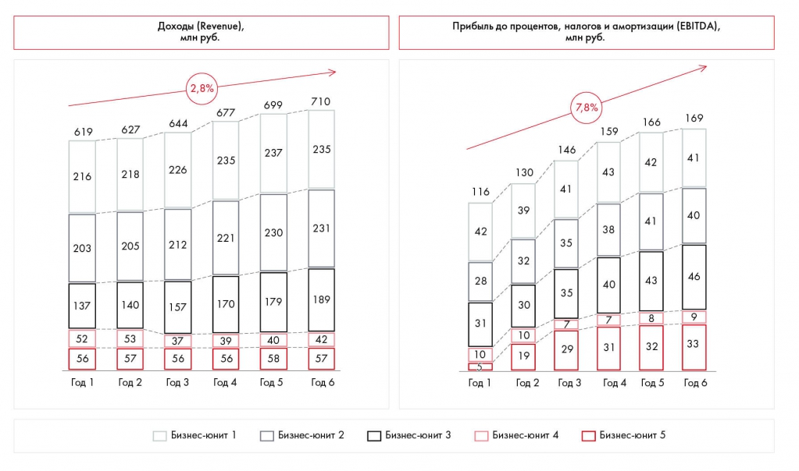

# Иллюстрация: PDF 120, изображение 1

На рисунке приведены элементы: 619; 216; 203; 137; 52. Полная текстовая расшифровка приведена отдельно; геометрия и цветовые обозначения сохранены на изображении.

Источник: [PDF 120](../../SOURCE.md#pdf-120).

Необходимая тема: [Практические задания 8.1–8.3: расчёты и выводы](../../chapters/08-analysis-visualization/exercises/01-data-analysis.md).

## Текст изображения

> Автоматическая расшифровка. Подписи в сложных слайдах, рукописный текст и порядок колонок могут содержать ошибки OCR. Уточнения, проверенные таблицы и формулы выше имеют приоритет. Не интерпретируйте отсутствие распознанного текста как отсутствие данных в рисунке.

- 619
- 216
- 203
- 137
- 52
- 56
- Год 1
- 627
- 218
- Доходы (Revenue),
- млн руб.
- 2,8%
- 677
- 235
- Прибыль до процентов, нагов и сортизии (ЕВ,
- млн руб.
- 7,8%
- 205
- 140
- 53
- 57
- Год 2
- 644
- 226
- 212
- 157
- 37
- 56
- Год 3
- 699
- 237
- 710
- 235
- 231
- 221
- 170
- 39
- 56
- Год 4
- 230
- 179
- 40
- 58
- Год 5
- 189
- 42
- 57
- Год 6
- 116
- 42
- 28
- 31
- 10
- Год 1
- 130
- 39
- 32
- 30
- 10
- 19
- Год 2
- 146
- 41
- 35
- 35
- 29
- Год 3
- 159
- 43
- 38
- 40
- 31
- Год 4
- 166
- 42
- 41
- 43
- 8
- 32
- Год 5
- 169
- 41
- 40
- 46
- 9
- 33
- Год 6
- Бизнес-юнит 1
- Бизнес-юнит 2
- Бизнес-юнит 3
- Бизнес-юнит 4
- Бизнес-юнит 5

## Связанные материалы

[Вернуться к теме](../../chapters/08-analysis-visualization/exercises/01-data-analysis.md) · [Ограничения распознавания](../../meta/issues.md)
