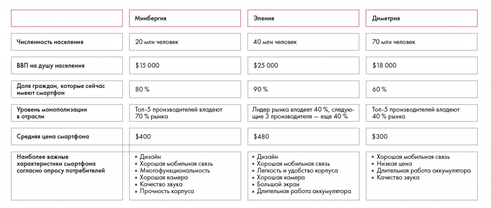

# Иллюстрация: PDF 121, изображение 1

Дерево факторов оценки рынка смартфонов связывает размер населения, обеспеченность смартфонами, доход, монополизацию и цену. Ветки нужны для выбора данных, влияющих на результат.

Источник: [PDF 121](../../SOURCE.md#pdf-121).

Необходимая тема: [Практические задания 8.1–8.3: расчёты и выводы](../../chapters/08-analysis-visualization/exercises/01-data-analysis.md).

## Текст изображения

> Автоматическая расшифровка. Подписи в сложных слайдах, рукописный текст и порядок колонок могут содержать ошибки OCR. Уточнения, проверенные таблицы и формулы выше имеют приоритет. Не интерпретируйте отсутствие распознанного текста как отсутствие данных в рисунке.

- Численность населения
- ВВП на душу населения
- Доля граждан, которые сейчас
- имеют смартфон
- Уровень монополизации
- в отрасли
- Средняя цена смартфона
- Наиболее важные
- характеристики смартфона
- согласно опросу потребителей
- Минбергия
- 20 млн человек
- $ 15 000
- 80 %
- Топ-5 производителей владеют
- 70 % рынка
- $400
- • Дизайн
- • Хорошая мобильная связь
- • Многофункциональность
- • Хорошая камера
- • Качество звука
- • Прочность корпуса
- Эления
- 40 млн человек
- $25 000
- 90 %
- Тидер рынка владеет 40 %, следую-
- щие 3 производителя — еще 40 %
- $480
- • Дизайн
- • Хорошая мобильная связь
- • Легкость и удобство корпуса
- • Хорошая камера
- • Большой экран
- • Длительная работа аккумулятора
- Диметрия
- 70 млн человек
- $18 000
- 60 %
- Топ-5 производителей владеют
- 40 % рынка
- $300
- • Хорошая мобильная связь
- • Низкая цена
- ачество звука

## Связанные материалы

[Вернуться к теме](../../chapters/08-analysis-visualization/exercises/01-data-analysis.md) · [Ограничения распознавания](../../meta/issues.md)
