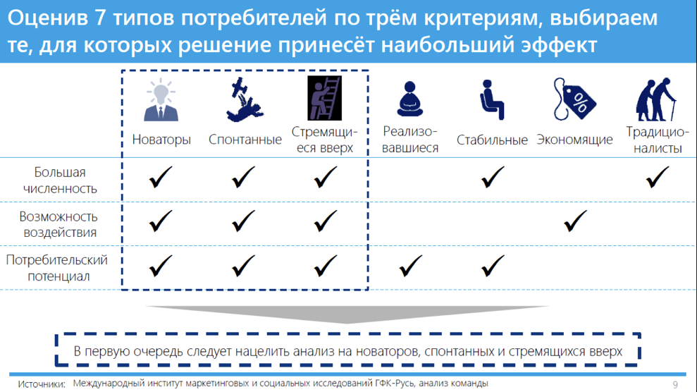

# Иллюстрация: PDF 121, изображение 2

На рисунке приведены элементы: Оценив 7 типов потребителей по трём критериям, выбираем; те, для которых решение принесёт наибольший эффект; Стремящи-; Новаторы Спонтанные; еся вверх. Полная текстовая расшифровка приведена отдельно; геометрия и цветовые обозначения сохранены на изображении.

Источник: [PDF 121](../../SOURCE.md#pdf-121).

Необходимая тема: [Практические задания 8.1–8.3: расчёты и выводы](../../chapters/08-analysis-visualization/exercises/01-data-analysis.md).

## Текст изображения

> Автоматическая расшифровка. Подписи в сложных слайдах, рукописный текст и порядок колонок могут содержать ошибки OCR. Уточнения, проверенные таблицы и формулы выше имеют приоритет. Не интерпретируйте отсутствие распознанного текста как отсутствие данных в рисунке.

- Оценив 7 типов потребителей по трём критериям, выбираем
- те, для которых решение принесёт наибольший эффект
- Стремящи-
- Новаторы Спонтанные
- еся вверх
- Реализо-
- вавшиеся
- Стабильные Экономящие
- Традицио-
- налисты
- Большая
- численность
- Возможность
- воздействия
- Потребительский
- потенциал
- В первую очередь следует нацелить анализ на новаторов, спонтанных и стремящихся вверх |
- L
- ------
- Источники: Международный институт маркетинговых и социальных исследований ГФК-Русь, анализ команды

## Связанные материалы

[Вернуться к теме](../../chapters/08-analysis-visualization/exercises/01-data-analysis.md) · [Ограничения распознавания](../../meta/issues.md)
