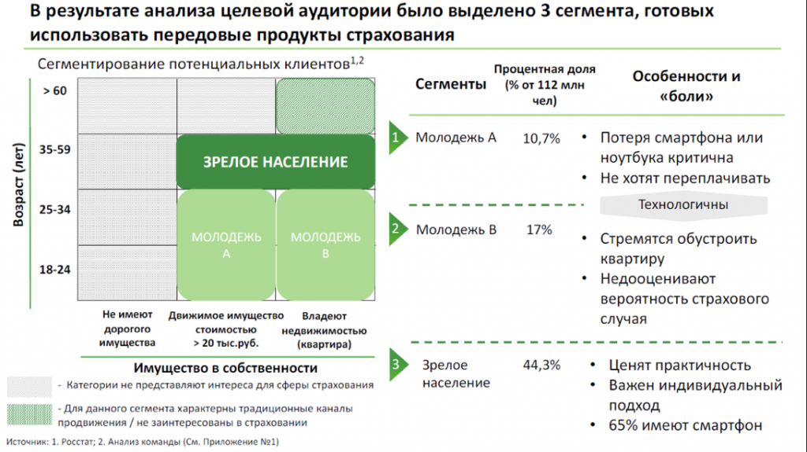

# Иллюстрация: PDF 123, изображение 1

Иллюстрация исходника: «Пример построения матрицы.». Подписи и числовые значения вынесены в расшифровку; порядок и связи элементов проверяются по сохранённому изображению.

Источник: [PDF 123](../../SOURCE.md#pdf-123).

Необходимая тема: [Практические задания 8.1–8.3: расчёты и выводы](../../chapters/08-analysis-visualization/exercises/01-data-analysis.md).

## Текст изображения

> Автоматическая расшифровка. Подписи в сложных слайдах, рукописный текст и порядок колонок могут содержать ошибки OCR. Уточнения, проверенные таблицы и формулы выше имеют приоритет. Не интерпретируйте отсутствие распознанного текста как отсутствие данных в рисунке.

- В результате анализа целевой аудитории было выделено 3 сегмента, готовых
- использовать передовые продукты страхования
- Сегментирование потенциальных клиентов1,2
- > 60
- Процентная доля
- Сегменты (% от 112 млн
- чел)
- Особенности и
- «боли»
- Возраст (лет)
- 35-59
- ЗРЕЛОЕ НАСЕЛЕНИЕ
- 25-34
- МОЛОДЕЖЬ
- МОЛОДЕЖЬ
- В
- 18-24
- Не имеют
- дорогого
- имущества
- Движимое имущество
- стоимостью
- > 20 тыс.руб.
- Владеют
- недвижимостью
- (квартира)
- Имущество в собственности
- - Категории не представляют интереса для сферы страхования
- - Для данного сегмента характерны традиционные каналы
- продвижения / не заинтересованы в страховании
- Источник: 1. Росстат; 2. Анализ команды (См. Приложение Nº1)
- • Молодежь А
- 2 Молодежь в
- 3 Зрелое
- население
- 10,7% Потеря смартфона или
- ноутбука критична
- • Не хотят переплачивать
- Технологичны
- 17%
- • Стремятся обустроить
- квартиру
- • Недооценивают
- вероятность страхового
- случая
- 44,3%
- • Ценят практичность
- • Важен индивидуальный
- ПодХод
- • 65% имеют смартфон

## Связанные материалы

[Вернуться к теме](../../chapters/08-analysis-visualization/exercises/01-data-analysis.md) · [Ограничения распознавания](../../meta/issues.md)
