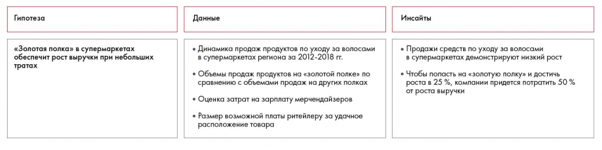

# Иллюстрация: PDF 124, изображение 1

На рисунке приведены элементы: Гипотеза; олотая полка» в супермаркет; еспечит рост выручки при небольш; тратах; Данные. Полная текстовая расшифровка приведена отдельно; геометрия и цветовые обозначения сохранены на изображении.

Источник: [PDF 124](../../SOURCE.md#pdf-124).

Необходимая тема: [Практические задания 8.1–8.3: расчёты и выводы](../../chapters/08-analysis-visualization/exercises/01-data-analysis.md).

## Текст изображения

> Автоматическая расшифровка. Подписи в сложных слайдах, рукописный текст и порядок колонок могут содержать ошибки OCR. Уточнения, проверенные таблицы и формулы выше имеют приоритет. Не интерпретируйте отсутствие распознанного текста как отсутствие данных в рисунке.

- Гипотеза
- олотая полка» в супермаркет
- еспечит рост выручки при небольш
- тратах
- Данные
- • Динамика продаж продуктов по уходу за волосами
- в супермаркетах региона за 2012-2018 гг.
- • Объемы продаж продуктов на «золотой полке» по
- сравнению с объемами продаж на других полках
- • Оценка затрат на зарплату мерчендайзеров
- • Размер возможной платы ритейлеру за удачное
- расположение товара
- Инсайты
- • Продажи средств по уходу за волосами
- • супермаркетах демонстрируют низкий рос
- • Чтобы попасть на «золотую полку» и достичь
- роста в 25 %, компании придется потратить 50%
- от роста выручки

## Связанные материалы

[Вернуться к теме](../../chapters/08-analysis-visualization/exercises/01-data-analysis.md) · [Ограничения распознавания](../../meta/issues.md)
