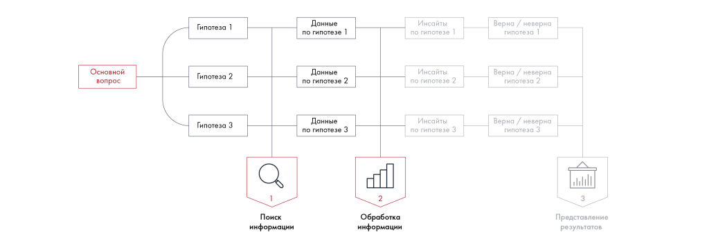

# Иллюстрация: PDF 125, изображение 1

Иллюстрация исходника: «формат, в котором представите информацию. Это может быть таблица,». Подписи и числовые значения вынесены в расшифровку; порядок и связи элементов проверяются по сохранённому изображению.

Источник: [PDF 125](../../SOURCE.md#pdf-125).

Необходимая тема: [Представление результата: типы диаграмм](../../chapters/08-analysis-visualization/02-charts.md).

## Текст изображения

> Автоматическая расшифровка. Подписи в сложных слайдах, рукописный текст и порядок колонок могут содержать ошибки OCR. Уточнения, проверенные таблицы и формулы выше имеют приоритет. Не интерпретируйте отсутствие распознанного текста как отсутствие данных в рисунке.

- Основной
- вопрос
- Гипотеза 1
- Данные
- по гипотезе 1
- Инсайты
- по гипотезе 1
- Гипотеза 2
- Данные
- по гипотезе 2
- Инсайты
- по гипотезе 2
- Гипотеза 3
- Данные
- по гипотезе 3
- Инсайты
- по гипотезе 3
- Поиск
- информации
- Обработка
- информации
- Верна / неверна
- гипотеза 1
- Верна / неверна
- гипотеза 2
- Верна / неверна
- гипотеза 3
- Представление
- результатов

## Связанные материалы

[Вернуться к теме](../../chapters/08-analysis-visualization/02-charts.md) · [Ограничения распознавания](../../meta/issues.md)
