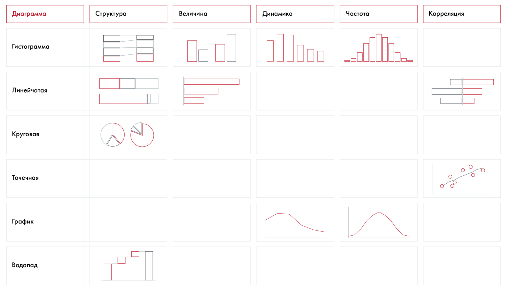

# Иллюстрация: PDF 126, изображение 1

Матрица сопоставляет образцы гистограмм, линейчатых, круговых, точечных диаграмм, графиков и водопада с задачами представления структуры, величины, динамики, частоты и корреляции. В ячейках показаны графические образцы; числовых данных для самостоятельного расчёта нет.

Источник: [PDF 126](../../SOURCE.md#pdf-126).

Необходимая тема: [Представление результата: типы диаграмм](../../chapters/08-analysis-visualization/02-charts.md).

## Текст изображения

> Автоматическая расшифровка. Подписи в сложных слайдах, рукописный текст и порядок колонок могут содержать ошибки OCR. Уточнения, проверенные таблицы и формулы выше имеют приоритет. Не интерпретируйте отсутствие распознанного текста как отсутствие данных в рисунке.

- Диаграмма
- Структура
- Величина
- Динамика
- Частота
- Корреляция
- Гистограмма
- Линейчатая
- Круговая
- Точечная
- 0800
- График
- Водопад

## Связанные материалы

[Вернуться к теме](../../chapters/08-analysis-visualization/02-charts.md) · [Ограничения распознавания](../../meta/issues.md)
