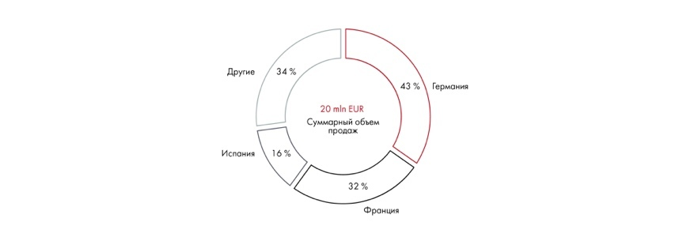

# Иллюстрация: PDF 126, изображение 2

Кольцевая диаграмма показывает разделение целого на части. Сектора располагаются от большего к меньшему, начиная от позиции «12 часов»; «Другое» помещается последним.

Источник: [PDF 126](../../SOURCE.md#pdf-126).

Необходимая тема: [Представление результата: типы диаграмм](../../chapters/08-analysis-visualization/02-charts.md).

## Текст изображения

> Автоматическая расшифровка. Подписи в сложных слайдах, рукописный текст и порядок колонок могут содержать ошибки OCR. Уточнения, проверенные таблицы и формулы выше имеют приоритет. Не интерпретируйте отсутствие распознанного текста как отсутствие данных в рисунке.

- Другие
- Испания
- 34 %
- 43 %
- 20 mln EUR
- Суммарный объем
- продаж
- 16%
- 32 %
- Франция
- Германия

## Связанные материалы

[Вернуться к теме](../../chapters/08-analysis-visualization/02-charts.md) · [Ограничения распознавания](../../meta/issues.md)
