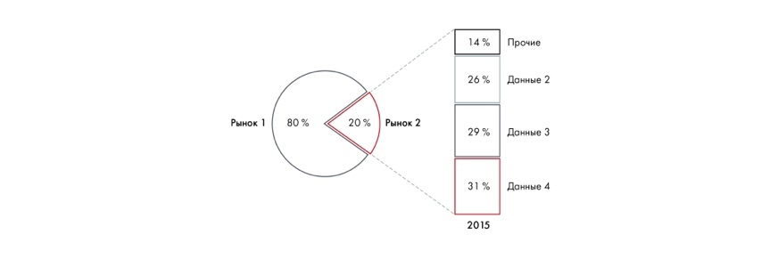

# Иллюстрация: PDF 127, изображение 1

Комбинация круга и колонки детализирует один сектор круговой диаграммы. Выбранная часть разворачивается в отдельную колонку с составляющими.

Источник: [PDF 127](../../SOURCE.md#pdf-127).

Необходимая тема: [Представление результата: типы диаграмм](../../chapters/08-analysis-visualization/02-charts.md).

## Текст изображения

> Автоматическая расшифровка. Подписи в сложных слайдах, рукописный текст и порядок колонок могут содержать ошибки OCR. Уточнения, проверенные таблицы и формулы выше имеют приоритет. Не интерпретируйте отсутствие распознанного текста как отсутствие данных в рисунке.

- Рынок 1
- 80 %
- 20%
- Рынок 2
- 14%
- 26%
- Прочие
- Данные 2
- 29 %
- Данные 3
- 31 %
- Данные 4
- 2015

## Связанные материалы

[Вернуться к теме](../../chapters/08-analysis-visualization/02-charts.md) · [Ограничения распознавания](../../meta/issues.md)
