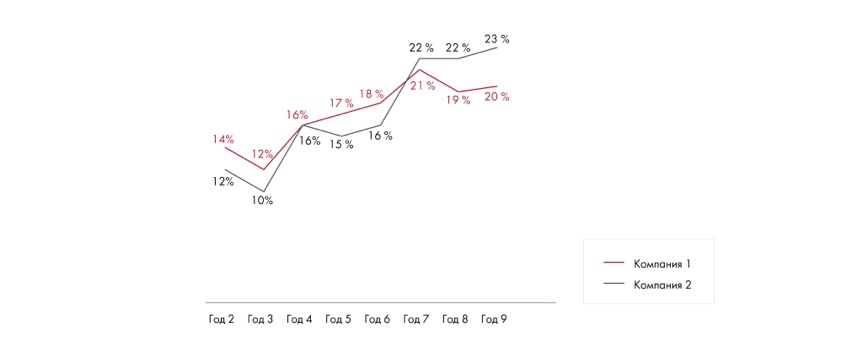

# Иллюстрация: PDF 127, изображение 3

Линейная диаграмма показывает тренд или сравнивает временные ряды. Для ясности в книге рекомендуется не более четырёх линий.

Источник: [PDF 127](../../SOURCE.md#pdf-127).

Необходимая тема: [Представление результата: типы диаграмм](../../chapters/08-analysis-visualization/02-charts.md).

## Текст изображения

> Автоматическая расшифровка. Подписи в сложных слайдах, рукописный текст и порядок колонок могут содержать ошибки OCR. Уточнения, проверенные таблицы и формулы выше имеют приоритет. Не интерпретируйте отсутствие распознанного текста как отсутствие данных в рисунке.

- 22% 22% 23%
- 21%
- 19% 20%
- 17% 18%
- 16%
- 16% 15%
- 16%
- 14%
- 12%
- 12%
- 10%
- Год 2 Год3 Год4 Год5 Годб Год7 Год 8 Год9
- Компания 1l
- - Компания 2

## Связанные материалы

[Вернуться к теме](../../chapters/08-analysis-visualization/02-charts.md) · [Ограничения распознавания](../../meta/issues.md)
