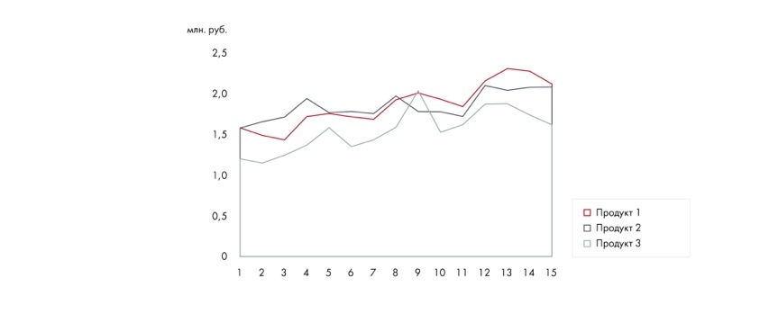

# Иллюстрация: PDF 127, изображение 4

Диаграмма с областями показывает значения нескольких факторов за период, их взаимный рост и совокупный эффект.

Источник: [PDF 127](../../SOURCE.md#pdf-127).

Необходимая тема: [Представление результата: типы диаграмм](../../chapters/08-analysis-visualization/02-charts.md).

## Текст изображения

> Автоматическая расшифровка. Подписи в сложных слайдах, рукописный текст и порядок колонок могут содержать ошибки OCR. Уточнения, проверенные таблицы и формулы выше имеют приоритет. Не интерпретируйте отсутствие распознанного текста как отсутствие данных в рисунке.

- млн. руб.
- 2,5
- 2,0
- 1,5
- 1,0
- 0,5
- • Продукт 1
- • Продукт 2
- • Продукт 3
- 2
- 3
- 4
- 567
- 89
- 10
- 11
- 12 13 14 15

## Связанные материалы

[Вернуться к теме](../../chapters/08-analysis-visualization/02-charts.md) · [Ограничения распознавания](../../meta/issues.md)
