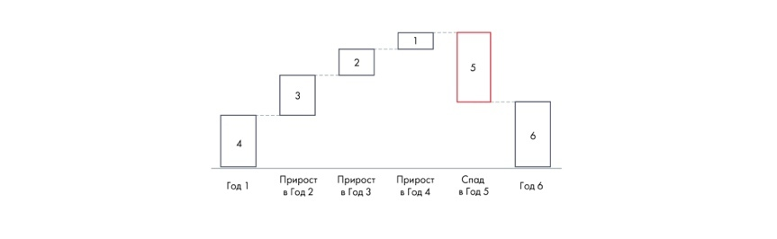

# Иллюстрация: PDF 128, изображение 1

Иллюстрация исходника: «диаграммы бывают полезны, когда». Подписи и числовые значения вынесены в расшифровку; порядок и связи элементов проверяются по сохранённому изображению.

Источник: [PDF 128](../../SOURCE.md#pdf-128).

Необходимая тема: [Представление результата: типы диаграмм](../../chapters/08-analysis-visualization/02-charts.md).

## Текст изображения

> Автоматическая расшифровка. Подписи в сложных слайдах, рукописный текст и порядок колонок могут содержать ошибки OCR. Уточнения, проверенные таблицы и формулы выше имеют приоритет. Не интерпретируйте отсутствие распознанного текста как отсутствие данных в рисунке.

- 4
- Год 1
- 3
- Прирос-
- в Год 2
- 2
- Прирост
- в Год 3
- Прост
- .пад
- 3 Год:
- Год б

## Связанные материалы

[Вернуться к теме](../../chapters/08-analysis-visualization/02-charts.md) · [Ограничения распознавания](../../meta/issues.md)
