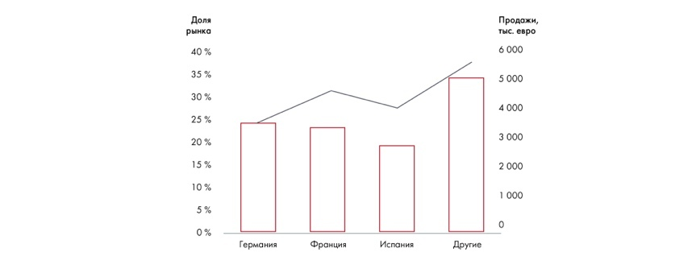

# Иллюстрация: PDF 128, изображение 2

Иллюстрация исходника: «диаграммы бывают полезны, когда». Подписи и числовые значения вынесены в расшифровку; порядок и связи элементов проверяются по сохранённому изображению.

Источник: [PDF 128](../../SOURCE.md#pdf-128).

Необходимая тема: [Представление результата: типы диаграмм](../../chapters/08-analysis-visualization/02-charts.md).

## Текст изображения

> Автоматическая расшифровка. Подписи в сложных слайдах, рукописный текст и порядок колонок могут содержать ошибки OCR. Уточнения, проверенные таблицы и формулы выше имеют приоритет. Не интерпретируйте отсутствие распознанного текста как отсутствие данных в рисунке.

- Доля
- рынка
- 40 %
- 35%
- 30 %
- 25 %
- 20 %
- 15%
- 10%
- 5 %
- 0%
- Продажи,
- тыс. евро
- 6 000
- 5 000
- 4 000
- 3 000
- 2000
- 1000
- Германия
- Франция
- Испания
- Другие

## Связанные материалы

[Вернуться к теме](../../chapters/08-analysis-visualization/02-charts.md) · [Ограничения распознавания](../../meta/issues.md)
