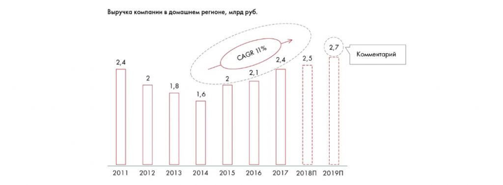

# Иллюстрация: PDF 130, изображение 1

Иллюстрация исходника: «Пример хорошего графика: единицы измерения подписаны, показан CAGR,». Подписи и числовые значения вынесены в расшифровку; порядок и связи элементов проверяются по сохранённому изображению.

Источник: [PDF 130](../../SOURCE.md#pdf-130).

Необходимая тема: [Представление результата: типы диаграмм](../../chapters/08-analysis-visualization/02-charts.md).

## Текст изображения

> Автоматическая расшифровка. Подписи в сложных слайдах, рукописный текст и порядок колонок могут содержать ошибки OCR. Уточнения, проверенные таблицы и формулы выше имеют приоритет. Не интерпретируйте отсутствие распознанного текста как отсутствие данных в рисунке.

- Выручка компании в домашнем регионе, млрд руб.
- 2,4
- CAGR 11%
- 2,1
- 2,7
- Комментарий
- 2,4
- 2,5
- 1,8
- 1,6
- 2011
- 2012
- 2013
- 2014
- 2015
- 2016
- 2017 2018П
- 2019П

## Связанные материалы

[Вернуться к теме](../../chapters/08-analysis-visualization/02-charts.md) · [Ограничения распознавания](../../meta/issues.md)
