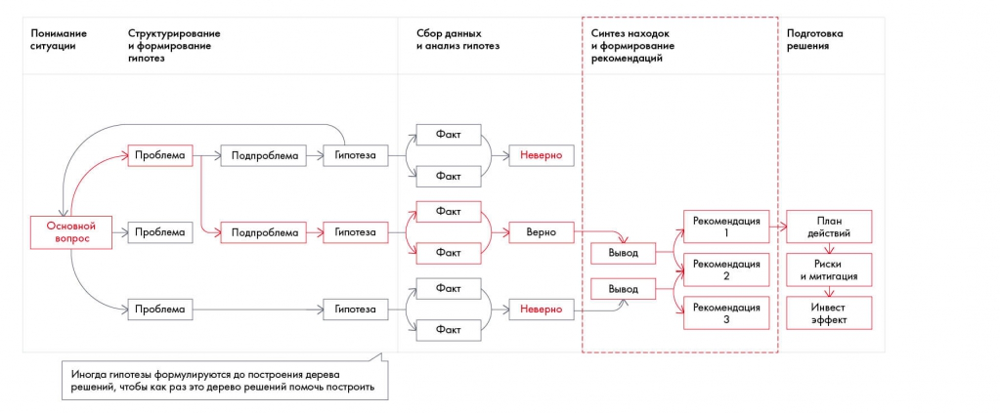

# Иллюстрация: PDF 133, изображение 1

На рисунке приведены элементы: Понимание; ситуации; Структурирование; и формирование; гипотез. Полная текстовая расшифровка приведена отдельно; геометрия и цветовые обозначения сохранены на изображении.

Источник: [PDF 133](../../SOURCE.md#pdf-133).

Необходимая тема: [Синтез данных](../../chapters/09-synthesis/01-synthesis.md).

## Текст изображения

> Автоматическая расшифровка. Подписи в сложных слайдах, рукописный текст и порядок колонок могут содержать ошибки OCR. Уточнения, проверенные таблицы и формулы выше имеют приоритет. Не интерпретируйте отсутствие распознанного текста как отсутствие данных в рисунке.

- Понимание
- ситуации
- Структурирование
- и формирование
- гипотез
- сбор данных
- и анализ гипотез
- Синтез находок
- и формирование
- рекомендаций
- Подготовка
- решения
- Факт
- • Проблема
- > Подпроблема
- > Гипотеза
- Неверно
- Факт
- Факт
- Основной
- вопрос
- > Проблема
- Подпроблема
- Гипотеза
- Верно
- Рекомендация
- Факт
- Факт
- Вывод
- Рекомендация
- Вывод
- > Проблема
- > Гипотеза
- Неверно
- Рекомендация
- 3
- План
- действий
- Риски
- и митигация
- Инвест
- эффект
- Факт
- Иногда гипотезы формулируются до построения дерева
- решений, чтобы как раз это дерево решений помочь построить

## Связанные материалы

[Вернуться к теме](../../chapters/09-synthesis/01-synthesis.md) · [Ограничения распознавания](../../meta/issues.md)
