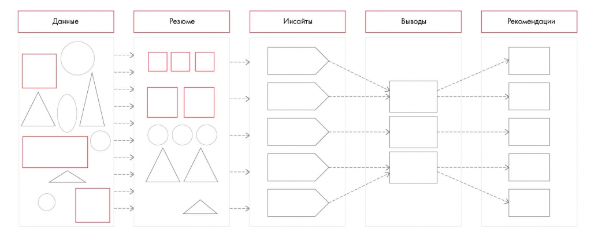

# Иллюстрация: PDF 134, изображение 1

Последовательность синтеза: данные → резюме → инсайты → выводы → рекомендации. Каждый следующий уровень должен опираться на предыдущий.

Источник: [PDF 134](../../SOURCE.md#pdf-134).

Необходимая тема: [Синтез данных](../../chapters/09-synthesis/01-synthesis.md).

## Текст изображения

> Автоматическая расшифровка. Подписи в сложных слайдах, рукописный текст и порядок колонок могут содержать ошибки OCR. Уточнения, проверенные таблицы и формулы выше имеют приоритет. Не интерпретируйте отсутствие распознанного текста как отсутствие данных в рисунке.

- Данные
- Резюме
- Инсайты
- Выводы
- Рекомендации

## Связанные материалы

[Вернуться к теме](../../chapters/09-synthesis/01-synthesis.md) · [Ограничения распознавания](../../meta/issues.md)
