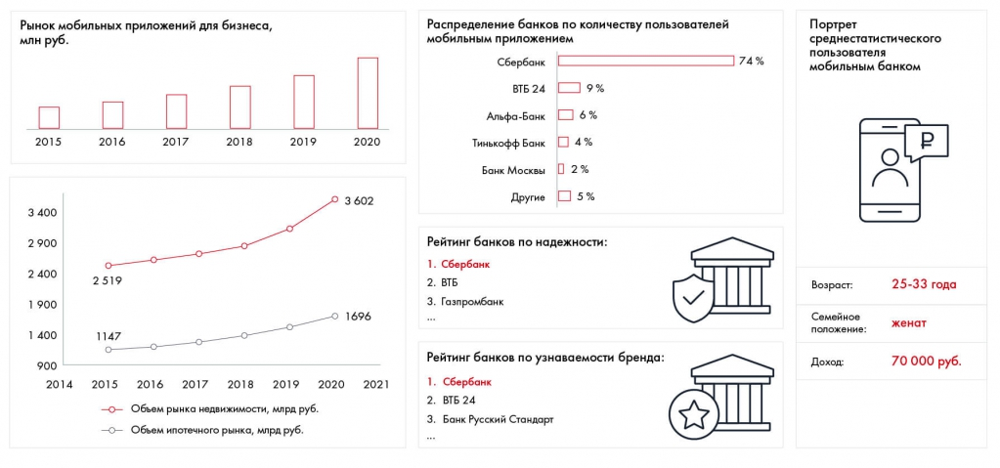

# Иллюстрация: PDF 136, изображение 1

На рисунке приведены элементы: Рынок мобильных приложений для бизнеса,; млн руб.; 2015; 2016; 2017. Полная текстовая расшифровка приведена отдельно; геометрия и цветовые обозначения сохранены на изображении.

Источник: [PDF 136](../../SOURCE.md#pdf-136).

Необходимая тема: [Формулирование рекомендаций с помощью синтеза](../../chapters/09-synthesis/02-recommendations.md).

## Текст изображения

> Автоматическая расшифровка. Подписи в сложных слайдах, рукописный текст и порядок колонок могут содержать ошибки OCR. Уточнения, проверенные таблицы и формулы выше имеют приоритет. Не интерпретируйте отсутствие распознанного текста как отсутствие данных в рисунке.

- Рынок мобильных приложений для бизнеса,
- млн руб.
- 2015
- 2016
- 2017
- 2018
- 2019
- 2020
- 3 400
- 2900
- 2 400
- 1900
- 1400
- 900
- 2014
- • 3602
- 2 519
- 1147
- 2015
- 2016 2017
- 2018 2019
- 2020
- -о Объем рынка недвижимости, мард руб.
- -о- Объем ипотечного рынка, мард руб.
- 1696
- 2021
- Распределение банков по количеству пользователей
- мобильным приложением
- Сбербанк
- ВТБ 24
- 9 %
- Альфа-Банк
- 6 %
- Тинькофф Банк
- 4 %
- Банк Москвы
- • 2%
- Другие
- 5 %
- Рейтинг банков по надежности:
- 1. Сбербанк
- 2. ВТБ
- 3. Газпромбанк
- 74%
- Портрет
- среднестатистического
- пользователя
- мобильным банком
- Возраст:
- Семейное
- положение:
- Доход:
- 25-33 года
- женат
- 70 000 руб.
- Рейтинг банков по узнаваемости бренда:
- 1. Сбербанк
- 2. ВТБ 24
- 3. Банк Русский Стандарт

## Связанные материалы

[Вернуться к теме](../../chapters/09-synthesis/02-recommendations.md) · [Ограничения распознавания](../../meta/issues.md)
