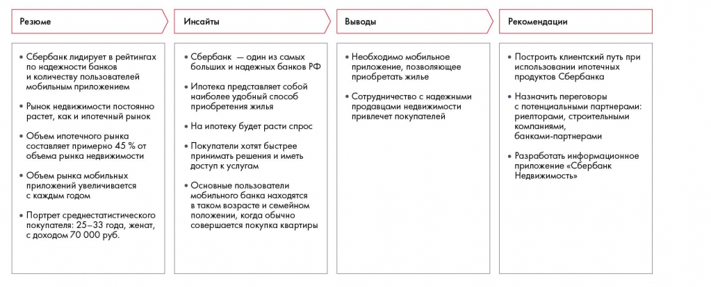

# Иллюстрация: PDF 140, изображение 1

Пример синтеза для Сбербанка: факты о надёжности, ипотеке и мобильном банкинге переходят в инсайты, затем в вывод о мобильном приложении и конкретные действия с партнёрами.

Источник: [PDF 140](../../SOURCE.md#pdf-140).

Необходимая тема: [Формулирование рекомендаций с помощью синтеза](../../chapters/09-synthesis/02-recommendations.md).

## Текст изображения

> Автоматическая расшифровка. Подписи в сложных слайдах, рукописный текст и порядок колонок могут содержать ошибки OCR. Уточнения, проверенные таблицы и формулы выше имеют приоритет. Не интерпретируйте отсутствие распознанного текста как отсутствие данных в рисунке.

- Резюме
- • Сбербанк лидирует в рейтингах
- по надежности банков
- и количеству пользователей
- мобильным приложением
- • Рынок недвижимости постоянно
- растет, как и ипотечный рынок
- • Объем ипотечного рынка
- составляет примерно 45 % от
- объема рынка недвижимости
- • Объем рынка мобильных
- приложений увеличивается
- с каждым годом
- • Портрет среднестатистического
- покупателя: 25-33 года, женат,
- с доходом 70 000 руб.
- Инсайты
- • Сбербанк - один из самых
- больших и надежных банков РФ
- • Ипотека представляет собой
- наиболее удобный способ
- приобретения жилья
- • На ипотеку будет расти спрос
- • Покупатели хотят быстрее
- принимать решения и иметь
- доступ к услугам
- • Основные пользователи
- мобильного банка находятся
- в таком возрасте и семейном
- положении, когда обычно
- совершается покупка квартиры
- Выводы
- • Необходимо мобильное
- приложение, позволяющее
- приобретать жилье
- • Сотрудничество с надежными
- продавцами недвижимости
- привлечет покупателей
- Рекомендации
- • Построить клиентский путь при
- использовании ипотечных
- продуктов Сбербанка
- • Назначить переговоры
- с потенциальными партнерами:
- риелторами, строительными
- компаниями,
- банками-партнерами
- • Разработать информационное
- приложение «Сбербанк
- Недвижимость»

## Связанные материалы

[Вернуться к теме](../../chapters/09-synthesis/02-recommendations.md) · [Ограничения распознавания](../../meta/issues.md)
