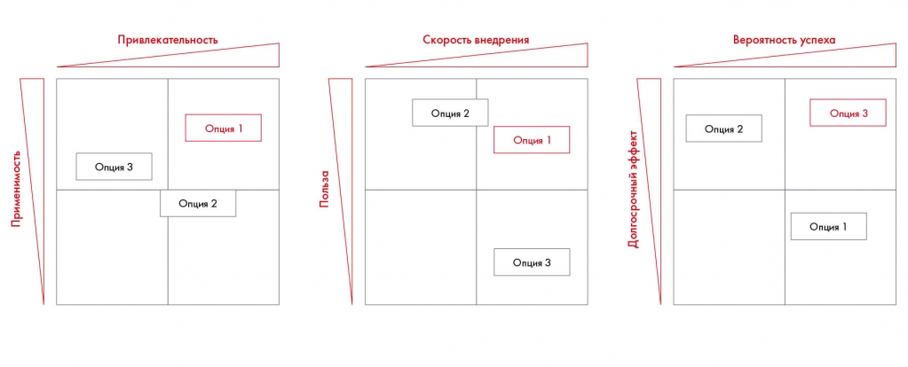

# Иллюстрация: PDF 141, изображение 1

Три матрицы сравнивают опции по привлекательности и применимости, пользе и скорости внедрения, вероятности успеха и долгосрочному эффекту.

Источник: [PDF 141](../../SOURCE.md#pdf-141).

Необходимая тема: [Сравнение альтернатив и рекомендации по Besh](../../chapters/09-synthesis/03-options.md).

## Текст изображения

> Автоматическая расшифровка. Подписи в сложных слайдах, рукописный текст и порядок колонок могут содержать ошибки OCR. Уточнения, проверенные таблицы и формулы выше имеют приоритет. Не интерпретируйте отсутствие распознанного текста как отсутствие данных в рисунке.

- Применимость
- Привлекательность
- Опция 1
- Опция 3
- Опция 2
- Польза
- Скорость внедрения
- Опция 2
- Опция 1
- Опция 3
- Долгосрочный эффект
- Вероятность успеха
- Опция 3
- Опция 2
- Опция 1

## Связанные материалы

[Вернуться к теме](../../chapters/09-synthesis/03-options.md) · [Ограничения распознавания](../../meta/issues.md)
