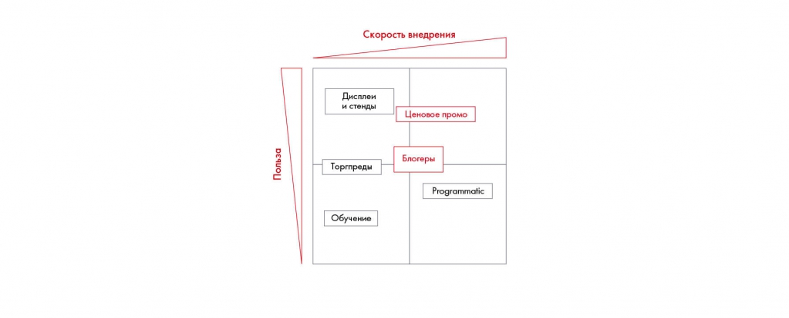

# Иллюстрация: PDF 144, изображение 1

Иллюстрация исходника: «Пример разложения по матрице». Подписи и числовые значения вынесены в расшифровку; порядок и связи элементов проверяются по сохранённому изображению.

Источник: [PDF 144](../../SOURCE.md#pdf-144).

Необходимая тема: [Сравнение альтернатив и рекомендации по Besh](../../chapters/09-synthesis/03-options.md).

## Текст изображения

> Автоматическая расшифровка. Подписи в сложных слайдах, рукописный текст и порядок колонок могут содержать ошибки OCR. Уточнения, проверенные таблицы и формулы выше имеют приоритет. Не интерпретируйте отсутствие распознанного текста как отсутствие данных в рисунке.

- Польза
- Скорость внедрения
- Дисплеи
- и стенды
- Ценовое промо
- Блогеры
- Торгреды
- Programmatic
- Обучение

## Связанные материалы

[Вернуться к теме](../../chapters/09-synthesis/03-options.md) · [Ограничения распознавания](../../meta/issues.md)
