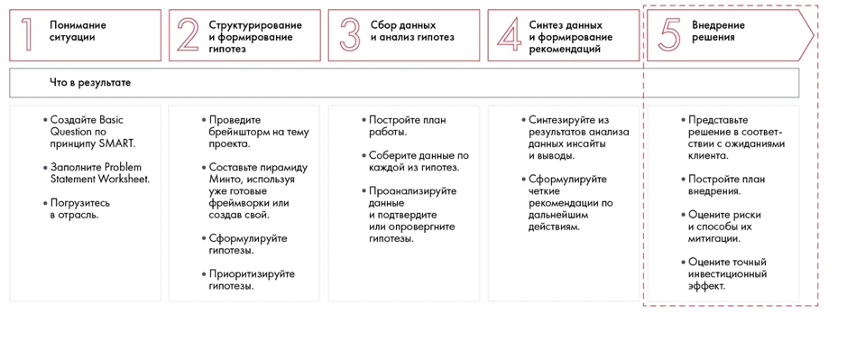

# Иллюстрация: PDF 145, изображение 1

Иллюстрация исходника: «План внедрения удобнее всего представлять в виде диаграммы Гантта. При оценке». Подписи и числовые значения вынесены в расшифровку; порядок и связи элементов проверяются по сохранённому изображению.

Источник: [PDF 145](../../SOURCE.md#pdf-145).

Необходимая тема: [План внедрения и диаграмма Гантта](../../chapters/10-solution/01-implementation.md).

## Текст изображения

> Автоматическая расшифровка. Подписи в сложных слайдах, рукописный текст и порядок колонок могут содержать ошибки OCR. Уточнения, проверенные таблицы и формулы выше имеют приоритет. Не интерпретируйте отсутствие распознанного текста как отсутствие данных в рисунке.

- Понимание
- ситуации
- Что в результате
- • Создайте Basic
- Question no
- принципу SMART.
- • Заполните Problem
- Statement Worksheet.
- • Погрузитесь
- в отрасль.
- 2
- Структурирование
- и формирование
- гипотез
- • Проведите
- брейншторм на тему
- проекта.
- • Составьте пирамиду
- Минто, используя
- уже готовые
- фреймворки или
- создав свой.
- • Сформулируйте
- гипотезы.
- • Приоритизируйте
- гипотезы.
- Сбор данных
- и анализ гипотез
- • Поборойте план
- • Соберите данные по
- каждой из гипотез.
- • Проанализируйте
- данные
- и подтвердите
- или опровергните
- гипотезы.
- Синтез данных
- и формирование
- рекомендаций
- • Синтезируйте из
- результатов анализа
- данных инсайты
- и выводы.
- • Сформулируйте
- четкие
- рекомендации по
- дальнейшим
- действиям.
- Внедрение
- решения
- • Представьте
- решение в соответ-
- ствии с ожиданиями
- клиента.
- • Постройте план
- внедрения.
- • Оцените риски
- и способы их
- митигоции.
- • Оцените точный
- инвестиционный
- эффект.

## Связанные материалы

[Вернуться к теме](../../chapters/10-solution/01-implementation.md) · [Ограничения распознавания](../../meta/issues.md)
