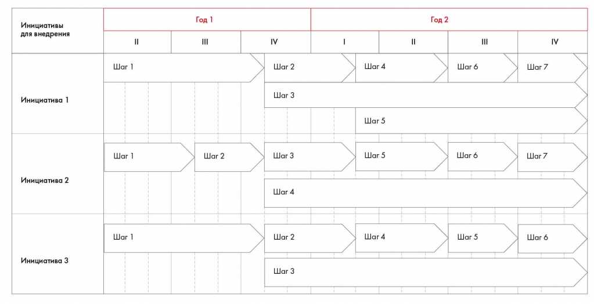

# Иллюстрация: PDF 149, изображение 1

Иллюстрация исходника: «Упрощенный вариант диаграммы Гантта». Подписи и числовые значения вынесены в расшифровку; порядок и связи элементов проверяются по сохранённому изображению.

Источник: [PDF 149](../../SOURCE.md#pdf-149).

Необходимая тема: [План внедрения и диаграмма Гантта](../../chapters/10-solution/01-implementation.md).

## Текст изображения

> Автоматическая расшифровка. Подписи в сложных слайдах, рукописный текст и порядок колонок могут содержать ошибки OCR. Уточнения, проверенные таблицы и формулы выше имеют приоритет. Не интерпретируйте отсутствие распознанного текста как отсутствие данных в рисунке.

- Инициативы
- для внедрения
- Инициатива 1
- Инициатива 2
- Инициатива 3
- II
- War 1
- Шаг 1
- Шаг 1
- Год 1
- III
- Шаг 2
- IV
- War 2
- War 3
- Шаг 3
- Шаг 4
- Шаг 2
- War 3
- Год 2
- III
- Шаг 4
- Шаг б
- Шаг 5
- Шаг 5
- Шаг 6
- Шаг 4
- Шаг 5
- IV
- Шаг 7
- Шаг 7
- Шаг 6

## Связанные материалы

[Вернуться к теме](../../chapters/10-solution/01-implementation.md) · [Ограничения распознавания](../../meta/issues.md)
