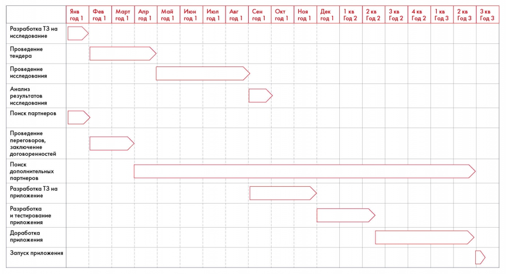

# Иллюстрация: PDF 150, изображение 1

План приложения распределяет исследование, поиск партнёров, техническое задание, разработку, тестирование и запуск по месяцам первого года и кварталам последующих лет. Точные интервалы читаются по полосам диаграммы.

Источник: [PDF 150](../../SOURCE.md#pdf-150).

Необходимая тема: [План внедрения и диаграмма Гантта](../../chapters/10-solution/01-implementation.md).

## Текст изображения

> Автоматическая расшифровка. Подписи в сложных слайдах, рукописный текст и порядок колонок могут содержать ошибки OCR. Уточнения, проверенные таблицы и формулы выше имеют приоритет. Не интерпретируйте отсутствие распознанного текста как отсутствие данных в рисунке.

- Янв
- год 1
- Фев
- год 1
- Март
- год 1
- Апр
- год 1
- Май
- год 1
- Июн
- год 1
- Июл
- год 1
- Авг
- год 1
- Сен
- год 1
- Окт
- год 1
- Ноя
- год 1
- Дек
- год 1
- 1 кв
- Год 2
- 2 кв
- Год 2
- 3 кв
- Год 2
- 4 кв.
- Год 2
- 1 кв
- Год 3
- 2 кв
- Год 3
- 3 кв
- Год 3
- Разработка Т3 на
- исследование
- Проведение
- тендера
- Проведение
- исследования
- Анализ
- результатов
- исследования
- Поиск партнеров
- Проведение
- переговоров,
- заключение
- договоренностей
- Поиск
- дополнительных
- партнеров
- Разработка ТЗ на
- приложение
- Разработка
- и тестирование
- приложения
- Доработка
- приложения
- Запуск приложения

## Связанные материалы

[Вернуться к теме](../../chapters/10-solution/01-implementation.md) · [Ограничения распознавания](../../meta/issues.md)
