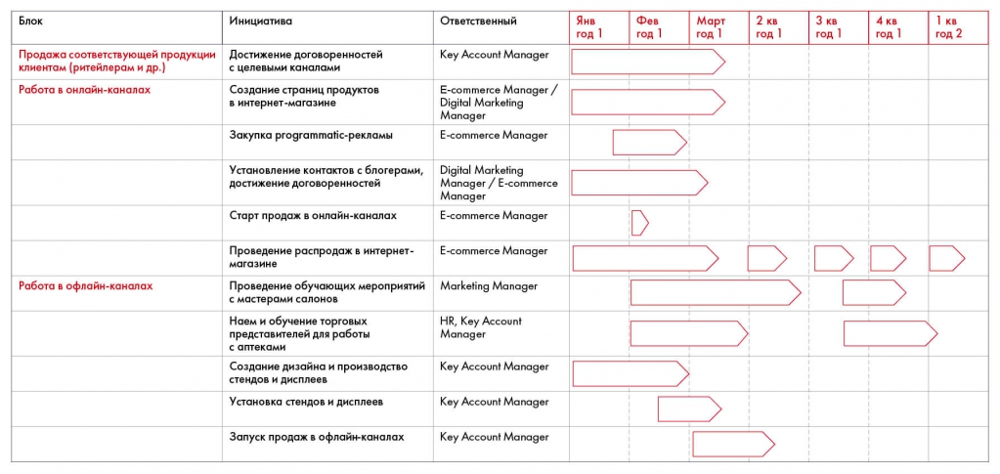

# Иллюстрация: PDF 152, изображение 1

Диаграмма Гантта Besh связывает инициативы онлайн- и офлайн-каналов с должностями ответственных и периодами внедрения. Сохранены все текстовые строки, временные полосы остаются на изображении.

Источник: [PDF 152](../../SOURCE.md#pdf-152).

Необходимая тема: [План внедрения и диаграмма Гантта](../../chapters/10-solution/01-implementation.md).

## Текст изображения

> Автоматическая расшифровка. Подписи в сложных слайдах, рукописный текст и порядок колонок могут содержать ошибки OCR. Уточнения, проверенные таблицы и формулы выше имеют приоритет. Не интерпретируйте отсутствие распознанного текста как отсутствие данных в рисунке.

- Блок
- Продажа соответствующей продукции
- клиентам (ритейлерам и др.)
- Работа в онлайн-каналах
- Работа в офлайн-каналах
- Инициатива
- Достижение договоренностей
- с целевыми каналами
- Создание страниц продуктов
- в интернет-магазине
- Закупка programmatic-рекламы
- Установление контактов с блогерами,
- достижение договоренностей
- Старт продаж в онлайн-каналах
- Проведение распродаж в интернет-
- магазине
- Проведение обучающих мероприятий
- с мастерами салонов
- Наем и обучение торговых
- представителей для работы
- с аптеками
- Создание дизайна и производство
- стендов и дисплеев
- Установка стендов и дисплеев
- Запуск продаж в офлайн-каналах
- Ответственный
- Key Account Manager
- E-commerce Manager /
- Digital Marketing
- Manager
- E-commerce Manager
- Digital Marketing
- Manager / E-commerce
- Manager
- E-commerce Manager
- E-commerce Manager
- Marketing Manager
- HR, Key Account
- Manager
- Key Account Manager
- Key Account Manager
- Key Account Manager
- Янв
- год 1
- Фев
- год 1
- Март
- год 1
- 2 кв
- год 1
- 3 кв
- год 1
- 4 кв
- год 1
- 1 кв
- год 2

## Связанные материалы

[Вернуться к теме](../../chapters/10-solution/01-implementation.md) · [Ограничения распознавания](../../meta/issues.md)
