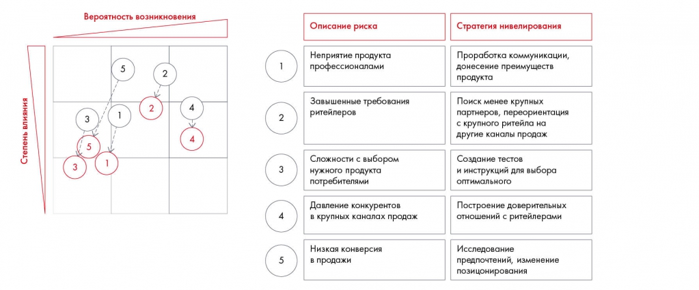

# Иллюстрация: PDF 153, изображение 1

Матрица пяти рисков Besh показывает вероятность и влияние до и после мер нивелирования. Таблица связывает каждый риск с отдельной стратегией снижения.

Источник: [PDF 153](../../SOURCE.md#pdf-153).

Необходимая тема: [Оценка рисков и меры нивелирования](../../chapters/10-solution/02-risks.md).

## Текст изображения

> Автоматическая расшифровка. Подписи в сложных слайдах, рукописный текст и порядок колонок могут содержать ошибки OCR. Уточнения, проверенные таблицы и формулы выше имеют приоритет. Не интерпретируйте отсутствие распознанного текста как отсутствие данных в рисунке.

- Вероятность возникновения
- Описание риска
- Неприятие продукта
- профессионалами
- Степень влияния
- Завышенные требования
- ритейлеров
- Сложности с выбором
- нужного продукта
- потребителями
- Давление конкурентов
- в крупных каналах продаж
- Низкая конверсия
- в продажи
- Стратегия нивелирования
- Проработка коммуникации,
- донесение преимуществ
- продукта
- Поиск менее крупных
- партнеров, переориентация
- с крупного ритейла на
- другие каналы продаж
- Создание тестов
- и инструкций для выбора
- оптимального
- Построение доверительных
- отношений с ритейлерами
- Исследование
- предпочтений, изменение
- позицонирования

## Связанные материалы

[Вернуться к теме](../../chapters/10-solution/02-risks.md) · [Ограничения распознавания](../../meta/issues.md)
