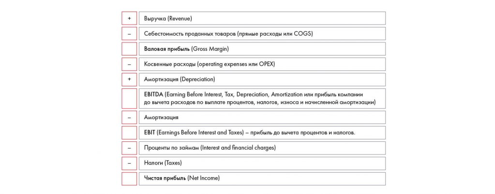

# Иллюстрация: PDF 161, изображение 1

На рисунке приведены элементы: Выручка (Revenue); Себестоимость проданных товаров (прямые расходы или COGS); Валовая прибыль (Gross Margin); Косвенные расходы (operating expenses или ОРЕХ); Амортизация (Depreciation). Полная текстовая расшифровка приведена отдельно; геометрия и цветовые обозначения сохранены на изображении.

Источник: [PDF 161](../../SOURCE.md#pdf-161).

Необходимая тема: [Финансовая оценка. Часть 1: прибыль и убытки](../../chapters/10-solution/03-pnl.md).

## Текст изображения

> Автоматическая расшифровка. Подписи в сложных слайдах, рукописный текст и порядок колонок могут содержать ошибки OCR. Уточнения, проверенные таблицы и формулы выше имеют приоритет. Не интерпретируйте отсутствие распознанного текста как отсутствие данных в рисунке.

- Выручка (Revenue)
- Себестоимость проданных товаров (прямые расходы или COGS)
- Валовая прибыль (Gross Margin)
- Косвенные расходы (operating expenses или ОРЕХ)
- Амортизация (Depreciation)
- EBITDA (Earning Before Interest, Tax, Depreciation, Amortization или прибыль компании
- до вычета расходов по выплате процентов, налогов, износа и начисленной амортизации)
- Амортизация
- EBIT (Earnings Before Interest and Taxes) - прибыль до вычета процентов и налогов.
- Проценты по займам (Interest and financial charges)
- Налоги (Taxes)
- Чистая прибыль (Net Income)

## Связанные материалы

[Вернуться к теме](../../chapters/10-solution/03-pnl.md) · [Ограничения распознавания](../../meta/issues.md)
