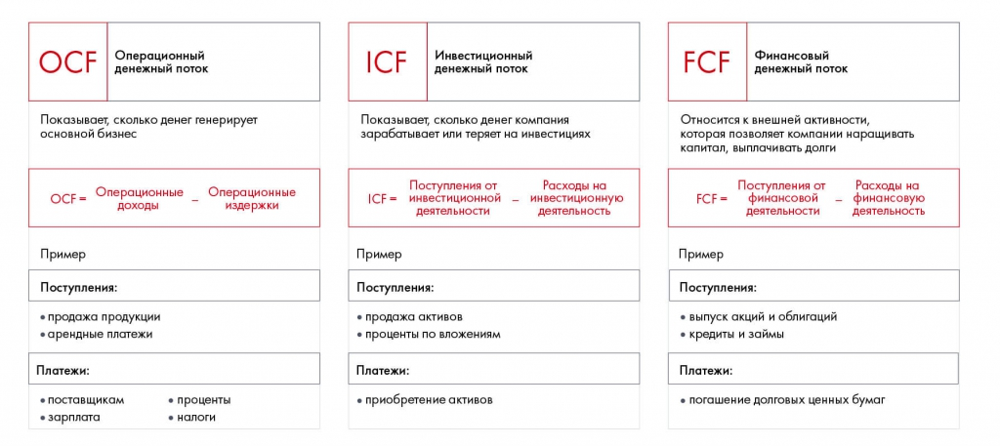

# Иллюстрация: PDF 163, изображение 1

На рисунке приведены элементы: OCF; Операционный; денежный поток; Показывает, сколько денег генерирует; основной бизнес. Полная текстовая расшифровка приведена отдельно; геометрия и цветовые обозначения сохранены на изображении.

Источник: [PDF 163](../../SOURCE.md#pdf-163).

Необходимая тема: [Отчёт о движении денежных средств](../../chapters/10-solution/04-cash-flow.md).

## Текст изображения

> Автоматическая расшифровка. Подписи в сложных слайдах, рукописный текст и порядок колонок могут содержать ошибки OCR. Уточнения, проверенные таблицы и формулы выше имеют приоритет. Не интерпретируйте отсутствие распознанного текста как отсутствие данных в рисунке.

- OCF
- Операционный
- денежный поток
- Показывает, сколько денег генерирует
- основной бизнес
- OCF- Операционные _ Операционные
- ДоХодЫ
- издержки
- Пример
- Поступления:
- • продажа продукции
- • арендные платежи
- Платежи:
- • поставщикам
- • зарплата
- • проценты
- • налоги
- ICF
- Инвестиционный
- денежный поток
- Показывает, сколько денег компания
- зарабатывает или теряет на инвестициях
- Поступления от
- Расходы на
- ICF - инвестиционной - инвестиционную
- деятельности
- деятельность
- Пример
- Поступления:
- • продажа активов
- • проценты по вложениям
- Платежи:
- • приобретение активов
- FCF
- Финансовый
- денежный поток
- Относится к внешней активности,
- которая позволяет компании наращивать
- капитал, выплачивать долги
- FCF -
- Поступления от
- финансовой
- деятельности
- Расходы на
- - финансовую
- деятельность
- Пример
- Поступления:
- • выпуск акций и облигаций
- • кредиты и займы
- Платежи:
- • погашение долговых ценных бумаг

## Связанные материалы

[Вернуться к теме](../../chapters/10-solution/04-cash-flow.md) · [Ограничения распознавания](../../meta/issues.md)
