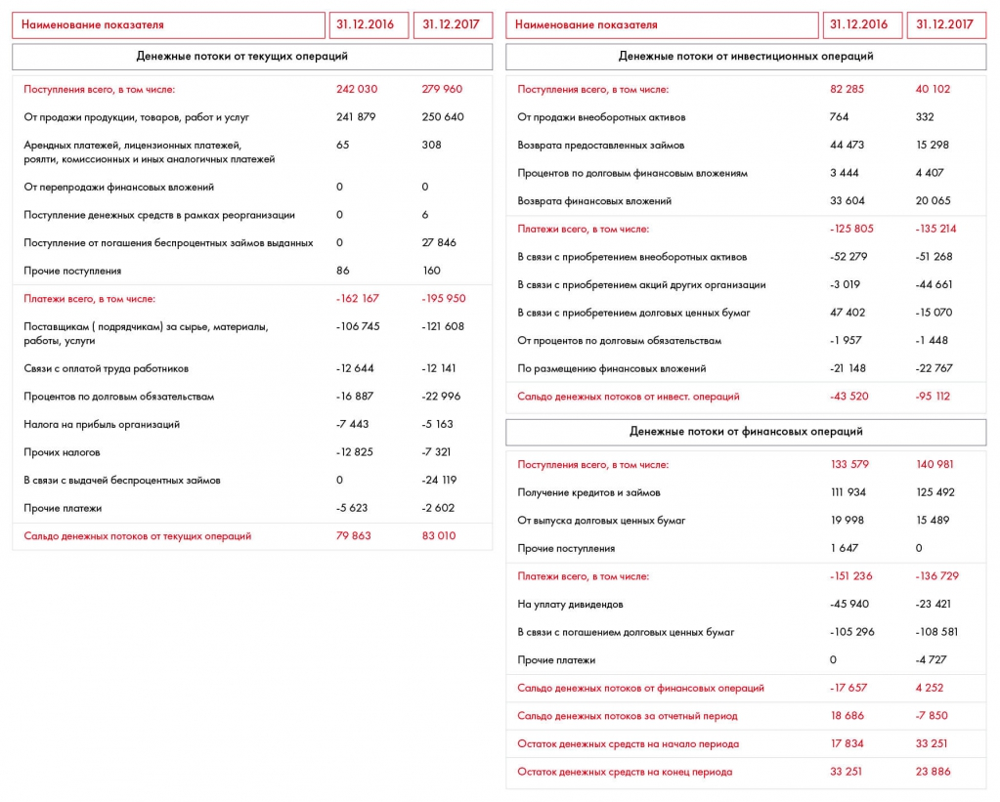

# Иллюстрация: PDF 166, изображение 1

Иллюстрация исходника: «Пример отчета о движении денежных средств». Подписи и числовые значения вынесены в расшифровку; порядок и связи элементов проверяются по сохранённому изображению.

Источник: [PDF 166](../../SOURCE.md#pdf-166).

Необходимая тема: [Финансовая оценка. Часть 2: баланс](../../chapters/10-solution/05-balance-sheet.md).

## Проверенная таблица

| Наименование показателя | 31.12.2016 | 31.12.2017 |
| --- | --- | --- |
| Денежные потоки от текущих операций |  |  |
| Поступления всего | 242 030 | 279 960 |
| От продажи продукции, товаров, работ и услуг | 241 879 | 250 640 |
| Арендные, лицензионные платежи, роялти, комиссионные и аналогичные платежи | 65 | 308 |
| От перепродажи финансовых вложений | 0 | 0 |
| Поступление в рамках реорганизации | 0 | 6 |
| Погашение беспроцентных займов выданных | 0 | 27 846 |
| Прочие поступления | 86 | 160 |
| Платежи всего | -162 167 | -195 950 |
| Поставщикам за сырьё, материалы, работы, услуги | -106 745 | -121 608 |
| В связи с оплатой труда работников | -12 644 | -12 141 |
| Проценты по долговым обязательствам | -16 887 | -22 996 |
| Налог на прибыль организаций | -7 443 | -5 163 |
| Прочие налоги | -12 825 | -7 321 |
| Выдача беспроцентных займов | 0 | -24 119 |
| Прочие платежи | -5 623 | -2 602 |
| Сальдо от текущих операций | 79 863 | 83 010 |
| Денежные потоки от инвестиционных операций |  |  |
| Поступления всего | 82 285 | 40 102 |
| Продажа внеоборотных активов | 764 | 332 |
| Возврат предоставленных займов | 44 473 | 15 298 |
| Проценты по долговым финансовым вложениям | 3 444 | 4 407 |
| Возврат финансовых вложений | 33 604 | 20 065 |
| Платежи всего | -125 805 | -135 214 |
| Приобретение внеоборотных активов | -52 279 | -51 268 |
| Приобретение акций других организаций | -3 019 | -44 661 |
| Приобретение долговых ценных бумаг | 47 402 | -15 070 |
| Проценты по долговым обязательствам | -1 957 | -1 448 |
| Размещение финансовых вложений | -21 148 | -22 767 |
| Сальдо от инвестиционных операций | -43 520 | -95 112 |
| Денежные потоки от финансовых операций |  |  |
| Поступления всего | 133 579 | 140 981 |
| Получение кредитов и займов | 111 934 | 125 492 |
| Выпуск долговых ценных бумаг | 19 998 | 15 489 |
| Прочие поступления | 1 647 | 0 |
| Платежи всего | -151 236 | -136 729 |
| Уплата дивидендов | -45 940 | -23 421 |
| Погашение долговых ценных бумаг | -105 296 | -108 581 |
| Прочие платежи | 0 | -4 727 |
| Сальдо от финансовых операций | -17 657 | 4 252 |
| Сальдо денежных потоков за отчётный период | 18 686 | -7 850 |
| Остаток на начало периода | 17 834 | 33 251 |
| Остаток на конец периода | 33 251 | 23 886 |

Редакторское примечание: знак у 47 402 передан как на изображении, хотя строка относится к платежам. Единицы в данном фрагменте не указаны. Названия длинных строк сокращены без изменения категории.

## Текст изображения

> Автоматическая расшифровка. Подписи в сложных слайдах, рукописный текст и порядок колонок могут содержать ошибки OCR. Уточнения, проверенные таблицы и формулы выше имеют приоритет. Не интерпретируйте отсутствие распознанного текста как отсутствие данных в рисунке.

- Наименование показателя
- 31.12.2016
- 31.12.2017
- Денежные потоки от текущих операций
- Поступления всего, в том числе:
- От продажи продукции, товаров, работ и услуг
- Арендных платежей, лицензионных платежей,
- роялти, комиссионных и иных аналогичных платежей
- От перепродажи финансовых вложений
- Поступление денежных средств в рамках реорганизации
- Поступление от погашения беспроцентных займов выданных
- Прочие поступления
- Платежи всего, в том числе:
- Поставщикам ( подрядчикам) за сырье, материалы,
- работы, услути
- Связи с оплатой труда работников
- Процентов по долговым обязательствам
- Налога на прибыль организаций
- Прочих налогов
- В связи с выдачей беспроцентных займов
- Прочие платежи
- Сальдо денежных потоков от текущих операций
- 242 030
- 241 879
- 65
- 86
- -162 167
- - 106 745
- - 12 644
- - 16 887
- -7 443
- - 12 825
- -5 623
- 79 863
- 279 960
- 250 640
- 308
- 27 846
- 160
- -195 950
- - 121 608
- -12 141
- -22 996
- -5 163
- -7 321
- -24 119
- -2 602
- 83 010
- Наименование показателя
- 31.12.2016
- 31.12.2017
- Денежные потоки от инвестиционных операций
- Поступления всего, в том числе:
- 82 285
- От продажи внеоборотных активов
- 764
- Возврата предоставленных займов
- 44 473
- Процентов по долговым финансовым вложениям
- 3 444
- Возврата финансовых вложений
- 33 604
- Платежи всего, в том числе:
- - 125 805
- В связи с приобретением внеоборотных активов
- -52 279
- В связи с приобретением акций других организации
- -3 019
- В связи с приобретением долговых ценных бумаг
- 47 402
- От процентов по долговым обязательствам
- -1 957
- По размещению финансовых вложений
- -21 148
- Сальдо денежных потоков от инвест. операций
- -43 520
- Денежные потоки от финансовых операций
- Поступления всего, в том числе:
- 133 579
- Получение кредитов и займов
- 111 934
- От выпуска долговых ценных бумаг
- 19 998
- Прочие поступления
- 1 647
- Платежи всего, в том числе:
- - 151 236
- На уплату дивидендов
- -45 940
- В связи с погашением долговых ценных бумаг
- - 105 296
- Прочие платежи
- Сальдо денежных потоков от финансовых операций
- - 17 657 |
- Сальдо денежных потоков за отчетный период
- 18 686
- Остаток денежных средств на начало периода
- 17 834
- Остаток денежных средств на конец периода
- 33 251
- 40 102
- 332
- 15 298
- 4 407
- 20 065
- - 135 214
- -51 268
- -44 661
- - 15 070
- -1 448
- -22 767
- -95 112
- 140 981
- 125 492
- 15 489
- - 136 729
- -23 421
- - 108 581
- -4727
- 4 252
- -7 850
- 33 251
- 23 886

## Связанные материалы

[Вернуться к теме](../../chapters/10-solution/05-balance-sheet.md) · [Ограничения распознавания](../../meta/issues.md)
