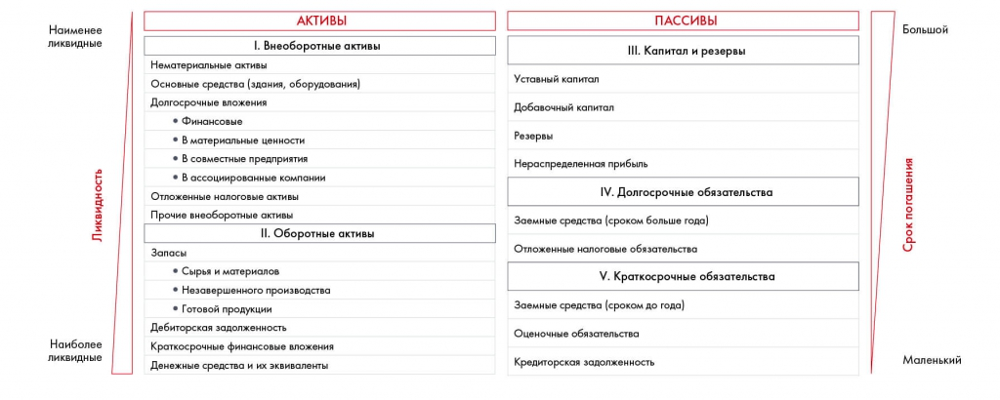

# Иллюстрация: PDF 167, изображение 1

Баланс сопоставляет активы и пассивы. Активы упорядочены от менее ликвидных внеоборотных к оборотным; обязательства — по сроку погашения вместе с капиталом и резервами.

Источник: [PDF 167](../../SOURCE.md#pdf-167).

Необходимая тема: [Финансовая оценка. Часть 2: баланс](../../chapters/10-solution/05-balance-sheet.md).

## Текст изображения

> Автоматическая расшифровка. Подписи в сложных слайдах, рукописный текст и порядок колонок могут содержать ошибки OCR. Уточнения, проверенные таблицы и формулы выше имеют приоритет. Не интерпретируйте отсутствие распознанного текста как отсутствие данных в рисунке.

- Наименее
- ликвидные
- Ликвидность
- Наиболее
- ликвидные
- АКТИВЫ
- І. Внеоборотные активы
- Нематериальные активы
- Основные средства (здания, оборудования)
- Долгосрочные вложения
- • Финансовые
- • В материальные ценности
- • В совместные предприятия
- • В ассоциированные компании
- Отложенные налоговые активы
- Прочие внеоборотные активы
- II. Оборотные активы
- Запасы
- • Сырья и материалов
- • Незавершенного производства
- • Готовой продукции
- Дебиторская задолженность
- Краткосрочные финансовые вложения
- Денежные средства и их эквиваленты
- ПАССИВЫ
- III. Капитал и резервы
- Уставный капитал
- Добавочный капитал
- Резервы
- Нераспределенная прибыль
- IV. Долгосрочные обязательства
- Заемные средства (сроком больше года)
- Отложенные налоговые обязательства
- V. Краткосрочные обязательства
- Заемные средства (сроком до года)
- Оценочные обязательства
- Кредиторская задолженность
- Большой
- Срок погашения
- Маленький

## Связанные материалы

[Вернуться к теме](../../chapters/10-solution/05-balance-sheet.md) · [Ограничения распознавания](../../meta/issues.md)
