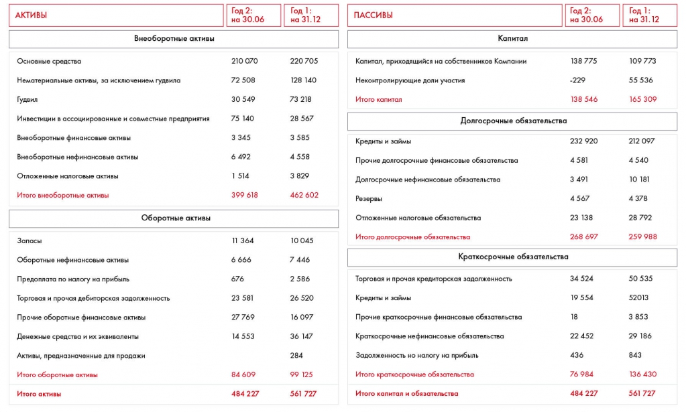

# Иллюстрация: PDF 167, изображение 2

На рисунке приведены элементы: АКТИВЫ; Внеоборотные активы; Основные средства; Нематериальные активы, за исключением гудвила; Гудвил. Полная текстовая расшифровка приведена отдельно; геометрия и цветовые обозначения сохранены на изображении.

Источник: [PDF 167](../../SOURCE.md#pdf-167).

Необходимая тема: [Финансовая оценка. Часть 2: баланс](../../chapters/10-solution/05-balance-sheet.md).

## Проверенная таблица

| Статья баланса | Год 2: на 30.06 | Год 1: на 31.12 |
| --- | --- | --- |
| АКТИВЫ |  |  |
| Внеоборотные активы |  |  |
| Основные средства | 210 070 | 220 705 |
| Нематериальные активы, кроме гудвила | 72 508 | 128 140 |
| Гудвил | 30 549 | 73 218 |
| Инвестиции в ассоциированные и совместные предприятия | 75 140 | 28 567 |
| Внеоборотные финансовые активы | 3 345 | 3 585 |
| Внеоборотные нефинансовые активы | 6 492 | 4 558 |
| Отложенные налоговые активы | 1 514 | 3 829 |
| Итого внеоборотные активы | 399 618 | 462 602 |
| Оборотные активы |  |  |
| Запасы | 11 364 | 10 045 |
| Оборотные нефинансовые активы | 6 666 | 7 446 |
| Предоплата по налогу на прибыль | 676 | 2 586 |
| Торговая и прочая дебиторская задолженность | 23 581 | 26 520 |
| Прочие оборотные финансовые активы | 27 769 | 16 097 |
| Денежные средства и эквиваленты | 14 553 | 36 147 |
| Активы, предназначенные для продажи |  | 284 |
| Итого оборотные активы | 84 609 | 99 125 |
| Итого активы | 484 227 | 561 727 |
| ПАССИВЫ |  |  |
| Капитал собственников компании | 138 775 | 109 773 |
| Неконтролирующие доли участия | -229 | 55 536 |
| Итого капитал | 138 546 | 165 309 |
| Долгосрочные обязательства |  |  |
| Кредиты и займы | 232 920 | 212 097 |
| Прочие долгосрочные финансовые обязательства | 4 581 | 4 540 |
| Долгосрочные нефинансовые обязательства | 3 491 | 10 181 |
| Резервы | 4 567 | 4 378 |
| Отложенные налоговые обязательства | 23 138 | 28 792 |
| Итого долгосрочные обязательства | 268 697 | 259 988 |
| Краткосрочные обязательства |  |  |
| Торговая и прочая кредиторская задолженность | 34 524 | 50 535 |
| Кредиты и займы | 19 554 | 52 013 |
| Прочие краткосрочные финансовые обязательства | 18 | 3 853 |
| Краткосрочные нефинансовые обязательства | 22 452 | 29 186 |
| Задолженность по налогу на прибыль | 436 | 843 |
| Итого краткосрочные обязательства | 76 984 | 136 430 |
| Итого капитал и обязательства | 484 227 | 561 727 |

Единицы в данном фрагменте не подписаны. Пустая ячейка оставлена пустой, без подстановки нуля.

## Текст изображения

> Автоматическая расшифровка. Подписи в сложных слайдах, рукописный текст и порядок колонок могут содержать ошибки OCR. Уточнения, проверенные таблицы и формулы выше имеют приоритет. Не интерпретируйте отсутствие распознанного текста как отсутствие данных в рисунке.

- АКТИВЫ
- Внеоборотные активы
- Основные средства
- Нематериальные активы, за исключением гудвила
- Гудвил
- Инвестиции в ассоциированные и совместные предприятия
- Внеоборотные финансовые активы
- Внеоборотные нефинансовые активы
- Отложенные налоговые активы
- Итого внеоборотные активы
- Оборотные активы
- Запасы
- Оборотные нефинансовые активы
- Предоплата по налогу на прибыль
- Торговая и прочая дебиторская задолженность
- Прочие оборотные финансовые активы
- Денежные средства и их эквиваленты
- Активы, предназначенные для продажи
- Итого оборотные активы
- Итого активы
- Год 2:
- на 30.06
- 210 070
- 72 508
- 30 549
- 75 140
- 3 345
- 6 492
- 1 514
- 399 618
- 11 364
- 6 666
- 676
- 23 581
- 27769
- 14 553
- 84 609
- 484 227
- Год І:
- на 31.12
- 220 705
- 128 140
- 73 218
- 28 567
- 3 585
- 4 558
- 3 829
- 462 602
- 10 045
- 7 446
- 2 586
- 26 520
- 16 097
- 36 147
- 284
- 99 125
- 561 727
- ПАССИВЫ
- Год 2:
- на 30.06
- Год 1:
- на 31.12
- Капитал
- Капитал, приходящийся на собственников Компании
- Неконтролирующие доли участия
- Итого капитал
- Долгосрочные обязательства
- Кредиты и займы
- Прочие долгосрочные финансовые обязательства
- Долгосрочные нефинансовые обязательства
- Резервы
- Отложенные налоговые обязательства
- Итого долгосрочные обязательства
- Краткосрочные обязательства
- Торговая и прочая кредиторская задолженность
- Кредиты и займы
- Прочие краткосрочные финансовые обязательства
- Краткосрочные нефинансовые обязательства
- Задолженность но налогу на прибыль
- Итого краткосрочные обязательства
- Итого капитал и обязательства
- 138 775 |
- -229
- 138 546
- 232 920
- 4 581
- 3 491
- 4 567
- 23 138
- 268 697
- 109 773
- 55 536
- 165 309
- 212 097
- 4 540
- 10 181
- 4 378
- 28 792
- 259 988
- 34 524
- 19 554
- 18
- 22 452
- 436
- 76 984
- 484 227
- 50 535
- 52013
- 3 853
- 29 186
- 843
- 136 430
- 561 727

## Связанные материалы

[Вернуться к теме](../../chapters/10-solution/05-balance-sheet.md) · [Ограничения распознавания](../../meta/issues.md)
