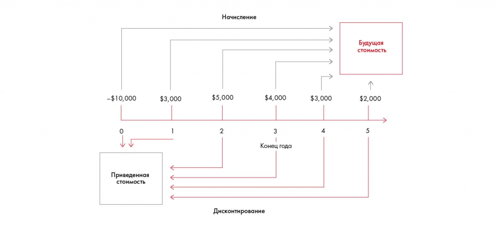

# Иллюстрация: PDF 172, изображение 1

На рисунке приведены элементы: -$10,000; →; Приведенная; СтОИМОСТЬ; $3,000. Полная текстовая расшифровка приведена отдельно; геометрия и цветовые обозначения сохранены на изображении.

Источник: [PDF 172](../../SOURCE.md#pdf-172).

Необходимая тема: [Финансовая оценка. Часть 3: стоимость бизнеса](../../chapters/10-solution/06-valuation.md).

## Текст изображения

> Автоматическая расшифровка. Подписи в сложных слайдах, рукописный текст и порядок колонок могут содержать ошибки OCR. Уточнения, проверенные таблицы и формулы выше имеют приоритет. Не интерпретируйте отсутствие распознанного текста как отсутствие данных в рисунке.

- -$10,000
- →
- Приведенная
- СтОИМОСТЬ
- $3,000
- Начисление
- $5,000
- $4,000
- 2
- Конец года
- Дисконтирование
- $3,000
- 4
- Будущая
- стоИМоСтЬ
- $2,000

## Связанные материалы

[Вернуться к теме](../../chapters/10-solution/06-valuation.md) · [Ограничения распознавания](../../meta/issues.md)
