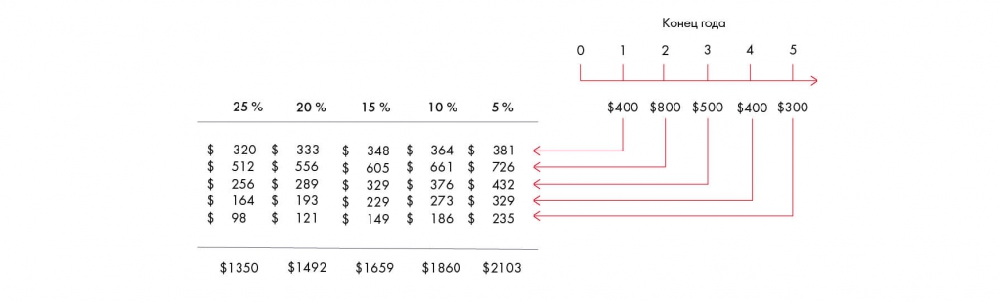

# Иллюстрация: PDF 173, изображение 1

Потоки 400, 800, 500, 400, 300 долларов в конце годов 1–5 дисконтируются по ставкам 25 %, 20 %, 15 %, 10 %, 5 %. Чем выше ставка, тем меньше приведённая стоимость; значения перенесены в таблицу.

Источник: [PDF 173](../../SOURCE.md#pdf-173).

Необходимая тема: [Финансовая оценка. Часть 3: стоимость бизнеса](../../chapters/10-solution/06-valuation.md).

## Проверенная таблица

| Поток, $ | 25 % | 20 % | 15 % | 10 % | 5 % |
| --- | --- | --- | --- | --- | --- |
| 400 | 320 | 333 | 348 | 364 | 381 |
| 800 | 512 | 556 | 605 | 661 | 726 |
| 500 | 256 | 289 | 329 | 376 | 432 |
| 400 | 164 | 193 | 229 | 273 | 329 |
| 300 | 98 | 121 | 149 | 186 | 235 |
| Итого | 1350 | 1492 | 1659 | 1860 | 2103 |

## Текст изображения

> Автоматическая расшифровка. Подписи в сложных слайдах, рукописный текст и порядок колонок могут содержать ошибки OCR. Уточнения, проверенные таблицы и формулы выше имеют приоритет. Не интерпретируйте отсутствие распознанного текста как отсутствие данных в рисунке.

- tA tA
- 4A LA
- $
- 25 %
- 320
- 512
- 256
- 164
- 98
- $1350
- $
- $
- 20 %
- 333
- 556
- 289
- 193
- 121
- $1492
- 15 %
- 10 %
- 5%
- $
- $
- $
- 348
- 605
- 329
- 229
- 149
- en en
- 364
- 661
- 376
- 273
- 186
- $
- LA LA
- 381
- 726
- 432
- 329
- 235
- $1659
- $1860
- $2103
- Конец года
- 2
- 3
- $400 $800
- $500
- $400
- $300

## Связанные материалы

[Вернуться к теме](../../chapters/10-solution/06-valuation.md) · [Ограничения распознавания](../../meta/issues.md)
