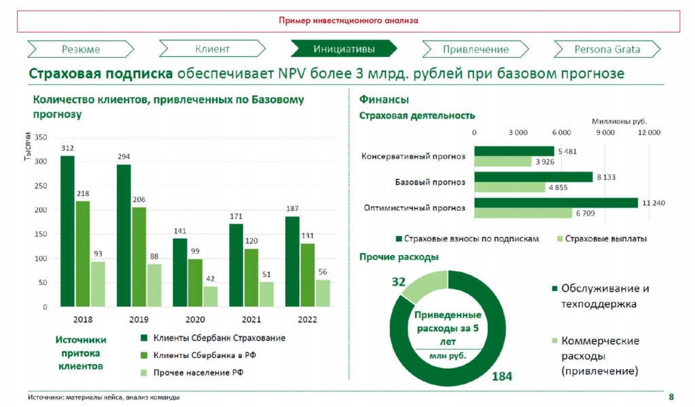

# Иллюстрация: PDF 176, изображение 1

Иллюстрация исходника: «Пример инвестиционного анализа. Источник: Changellenge≫ Cup Russia, решение». Подписи и числовые значения вынесены в расшифровку; порядок и связи элементов проверяются по сохранённому изображению.

Источник: [PDF 176](../../SOURCE.md#pdf-176).

Необходимая тема: [WACC, NPV, IRR, DPP, PI и ROI](../../chapters/10-solution/07-investment-metrics.md).

## Текст изображения

> Автоматическая расшифровка. Подписи в сложных слайдах, рукописный текст и порядок колонок могут содержать ошибки OCR. Уточнения, проверенные таблицы и формулы выше имеют приоритет. Не интерпретируйте отсутствие распознанного текста как отсутствие данных в рисунке.

- Пример инвестиционного анализа
- Резюме
- Клиент
- Инициативы
- Привлечение
- Persona Grata
- Страховая подписка обеспечивает NPV более 3 млрд. рублей при базовом прогнозе
- Количество клиентов, привлеченных по Базовому
- прогнозу
- · 350
- Тыся!
- 300
- 312
- 294
- 250
- 218
- 206
- 200
- 187
- 171
- 150
- 141
- 131
- 120
- 93
- 100
- 99
- 88
- 50
- 51
- 56
- 42
- 2018
- 2019
- 2020
- 2021
- 2022
- Источники
- притока
- клиентов
- Клиенты Сбербанк Страхование
- Клиенты Сбербанка в РФ
- Прочее население РФ
- Источники: материалы кейса, анализ команды
- Финансы
- Страховая деятельность
- 3 000
- 6 000
- Миллионы руб.
- 9 000
- 12 000
- 5 481
- Консервативный прогноз
- 3926
- 8 133
- Базовый прогноз
- 4 855
- 11 240
- Оптимистичный прогноз
- 6 709
- • Страховые взносы по подпискам
- • Страховые выплаты
- Прочие расходы
- 32
- Приведенные
- расходы за 5
- лет
- млн руб.
- • Обслуживание и
- техподдержка
- Коммерческие
- расходы
- (привлечение)
- 184
- 8

## Связанные материалы

[Вернуться к теме](../../chapters/10-solution/07-investment-metrics.md) · [Ограничения распознавания](../../meta/issues.md)
