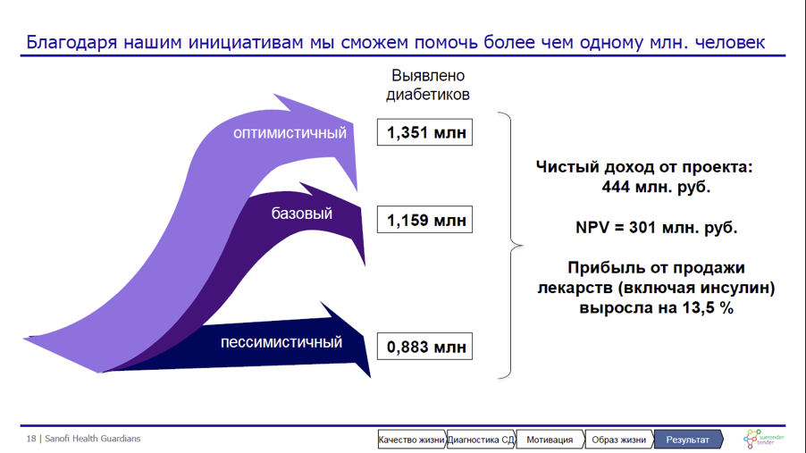

# Иллюстрация: PDF 177, изображение 1

Иллюстрация исходника: «Пример сценарного подхода. Источник: Sanofi Health Guardians, решение». Подписи и числовые значения вынесены в расшифровку; порядок и связи элементов проверяются по сохранённому изображению.

Источник: [PDF 177](../../SOURCE.md#pdf-177).

Необходимая тема: [Финансовая модель и сценарный анализ](../../chapters/10-solution/08-financial-model.md).

## Текст изображения

> Автоматическая расшифровка. Подписи в сложных слайдах, рукописный текст и порядок колонок могут содержать ошибки OCR. Уточнения, проверенные таблицы и формулы выше имеют приоритет. Не интерпретируйте отсутствие распознанного текста как отсутствие данных в рисунке.

- Благодаря нашим инициативам мы сможем помочь более чем одному млн. человек
- Выявлено
- диабетиков
- ОПТИМИСТИЧНЫЙ
- 1,351 млн
- базовый
- 1,159 млН
- Чистый доход от проекта:
- 444 млн. руб.
- NPV = 301 млн. руб.
- Прибыль от продажи
- лекарств (включая инсулин)
- выросла на 13,5 %
- пессимистичный
- 0,883 млн
- 18 | Sanofi Health Guardians
- Качество жизни Диагностика СД Мотивация Образ жизни Результат )

## Связанные материалы

[Вернуться к теме](../../chapters/10-solution/08-financial-model.md) · [Ограничения распознавания](../../meta/issues.md)
