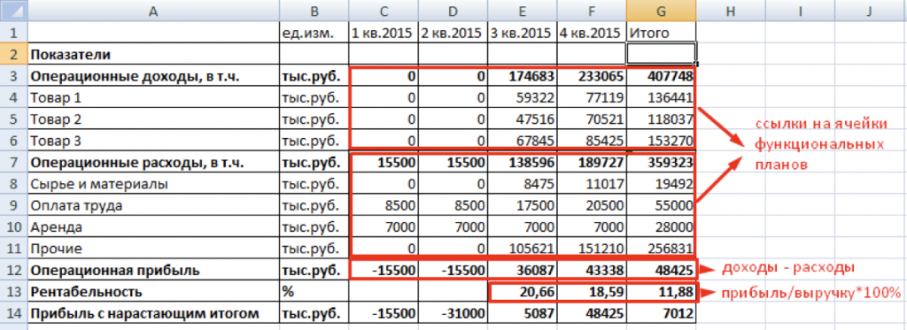

# Иллюстрация: PDF 178, изображение 1

На рисунке приведены элементы: A; Показатели; Операционные доходы, в т.ч.; 4; Товар 1. Полная текстовая расшифровка приведена отдельно; геометрия и цветовые обозначения сохранены на изображении.

Источник: [PDF 178](../../SOURCE.md#pdf-178).

Необходимая тема: [Финансовая модель и сценарный анализ](../../chapters/10-solution/08-financial-model.md).

## Текст изображения

> Автоматическая расшифровка. Подписи в сложных слайдах, рукописный текст и порядок колонок могут содержать ошибки OCR. Уточнения, проверенные таблицы и формулы выше имеют приоритет. Не интерпретируйте отсутствие распознанного текста как отсутствие данных в рисунке.

- A
- Показатели
- Операционные доходы, в т.ч.
- 4
- Товар 1
- 5
- Товар 2
- Товар 3
- Операционные расходы, в т.ч.
- 8 Сырье и материалы
- 9 Оплата труда
- 10 Аренда
- 11 Прочие
- 12
- Операционная прибыль
- 13|
- Рентабельность
- 14 Прибыль с нарастающим итогом
- ед.изм.
- тыс.руб.
- тыс.руб.
- тыс.руб.
- тыс.руб
- тыс.руб.
- тыс.руб.
- тыс.руб.
- тыс.руб.
- тыс.руб
- тыс.руб.
- %
- тыс.руб.
- D
- 1 кв.2015 2 кв.2015
- 0
- 0
- 15500
- 0
- 8500
- 7000
- Oll
- -15500
- -15500
- 15500
- 0
- 8500
- 7000
- -15500
- -31000
- E
- 3 кв.2015
- 174683
- 59322
- 47516
- 67845
- 138596
- 8475
- 17500
- 7000
- 105621
- 36087
- 20,66
- 5087
- F
- 4 кв.2015
- 233065
- 77119
- 70521
- 85425
- 189727
- 11017
- 20500
- 7000
- 151210
- 43338
- 18,59
- 48425
- G
- Итого
- 407748
- 136441
- 118037
- 153270
- 359323
- 19492
- 55000
- 28000
- 256831
- 48425
- 11,88
- 7012
- H
- 1
- J
- ссылки на ячейки
- функциональных
- планов
- доходы - расходы
- прибыль/выручку*100%

## Связанные материалы

[Вернуться к теме](../../chapters/10-solution/08-financial-model.md) · [Ограничения распознавания](../../meta/issues.md)
