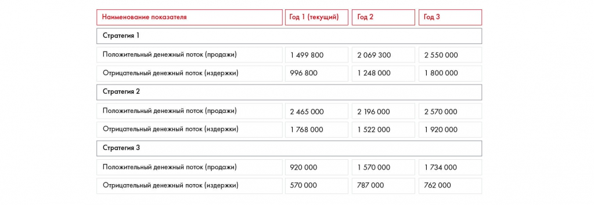

# Иллюстрация: PDF 179, изображение 2

На рисунке приведены элементы: Наименование показателя; Стратегия 1; Положительный денежный поток (продажи); Отрицательный денежный поток (издержки); Стратегия 2. Полная текстовая расшифровка приведена отдельно; геометрия и цветовые обозначения сохранены на изображении.

Источник: [PDF 179](../../SOURCE.md#pdf-179).

Необходимая тема: [Финансовая модель и сценарный анализ](../../chapters/10-solution/08-financial-model.md).

## Проверенная таблица

| Стратегия / показатель | Год 1 (текущий) | Год 2 | Год 3 |
| --- | --- | --- | --- |
| Стратегия 1: положительный поток (продажи) | 1 499 800 | 2 069 300 | 2 550 000 |
| Стратегия 1: отрицательный поток (издержки) | 996 800 | 1 248 000 | 1 800 000 |
| Стратегия 2: положительный поток (продажи) | 2 465 000 | 2 196 000 | 2 570 000 |
| Стратегия 2: отрицательный поток (издержки) | 1 768 000 | 1 522 000 | 1 920 000 |
| Стратегия 3: положительный поток (продажи) | 920 000 | 1 570 000 | 1 734 000 |
| Стратегия 3: отрицательный поток (издержки) | 570 000 | 787 000 | 762 000 |

Единица в самой таблице не подписана; денежные величины не переименованы редактором.

## Текст изображения

> Автоматическая расшифровка. Подписи в сложных слайдах, рукописный текст и порядок колонок могут содержать ошибки OCR. Уточнения, проверенные таблицы и формулы выше имеют приоритет. Не интерпретируйте отсутствие распознанного текста как отсутствие данных в рисунке.

- Наименование показателя
- Стратегия 1
- Положительный денежный поток (продажи)
- Отрицательный денежный поток (издержки)
- Стратегия 2
- Положительный денежный поток (продажи)
- Отрицательный денежный поток (издержки)
- Стратегия 3
- Положительный денежный поток (продажи)
- Отрицательный денежный поток (издержки)
- Год 1 (текущий)
- Год 2
- 1 499 800
- 996 800
- 2 069 300
- 1 248 000
- 2 465 000
- 1768 000
- 2 196 000
- 1 522 000
- 920 000
- 570 000
- 1 570 000
- 787 000
- Год 3
- 2 550 000
- 1 800 000
- 2 570 000
- 1 920 000
- 1 734 000
- 762 000

## Связанные материалы

[Вернуться к теме](../../chapters/10-solution/08-financial-model.md) · [Ограничения распознавания](../../meta/issues.md)
