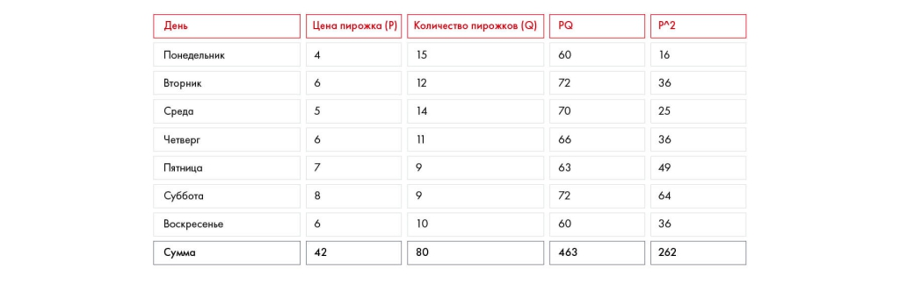

# Иллюстрация: PDF 181, изображение 2

На рисунке приведены элементы: День; Понедельник; Вторник; Среда; Четверг. Полная текстовая расшифровка приведена отдельно; геометрия и цветовые обозначения сохранены на изображении.

Источник: [PDF 181](../../SOURCE.md#pdf-181).

Необходимая тема: [Как делать прогнозы и предпосылки](../../chapters/10-solution/09-forecasting.md).

## Проверенная таблица

| День | Цена пирожка P | Количество Q | PQ | P² |
| --- | --- | --- | --- | --- |
| Понедельник | 4 | 15 | 60 | 16 |
| Вторник | 6 | 12 | 72 | 36 |
| Среда | 5 | 14 | 70 | 25 |
| Четверг | 6 | 11 | 66 | 36 |
| Пятница | 7 | 9 | 63 | 49 |
| Суббота | 8 | 9 | 72 | 64 |
| Воскресенье | 6 | 10 | 60 | 36 |
| Сумма | 42 | 80 | 463 | 262 |

## Текст изображения

> Автоматическая расшифровка. Подписи в сложных слайдах, рукописный текст и порядок колонок могут содержать ошибки OCR. Уточнения, проверенные таблицы и формулы выше имеют приоритет. Не интерпретируйте отсутствие распознанного текста как отсутствие данных в рисунке.

- День
- Понедельник
- Вторник
- Среда
- Четверг
- Пятница
- Суббота
- Воскресенье
- Сумма
- Цена пирожка (P)
- 4
- Количество пирожков (Q)
- 15
- 12
- 14
- 11
- 7
- 8
- 42
- 10
- 80
- PQ
- 60
- 72
- 70
- 66
- 63
- 72
- 60
- 463
- p^2
- 16
- 36
- 25
- 36
- 49
- 64
- 36
- 262

## Связанные материалы

[Вернуться к теме](../../chapters/10-solution/09-forecasting.md) · [Ограничения распознавания](../../meta/issues.md)
