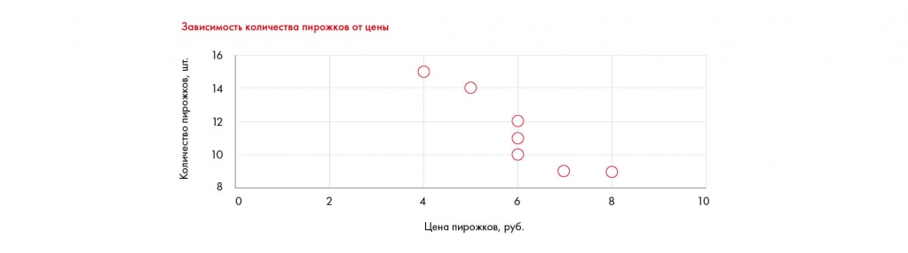

# Иллюстрация: PDF 182, изображение 1

На рисунке приведены элементы: Зависимость количества пирожков от цены; 16; 14; Количество пирожков,; 8. Полная текстовая расшифровка приведена отдельно; геометрия и цветовые обозначения сохранены на изображении.

Источник: [PDF 182](../../SOURCE.md#pdf-182).

Необходимая тема: [Как делать прогнозы и предпосылки](../../chapters/10-solution/09-forecasting.md).

## Текст изображения

> Автоматическая расшифровка. Подписи в сложных слайдах, рукописный текст и порядок колонок могут содержать ошибки OCR. Уточнения, проверенные таблицы и формулы выше имеют приоритет. Не интерпретируйте отсутствие распознанного текста как отсутствие данных в рисунке.

- Зависимость количества пирожков от цены
- 16
- 14
- Количество пирожков,
- 8
- 4
- 6
- Цена пирожков, руб.
- 8
- 10

## Связанные материалы

[Вернуться к теме](../../chapters/10-solution/09-forecasting.md) · [Ограничения распознавания](../../meta/issues.md)
