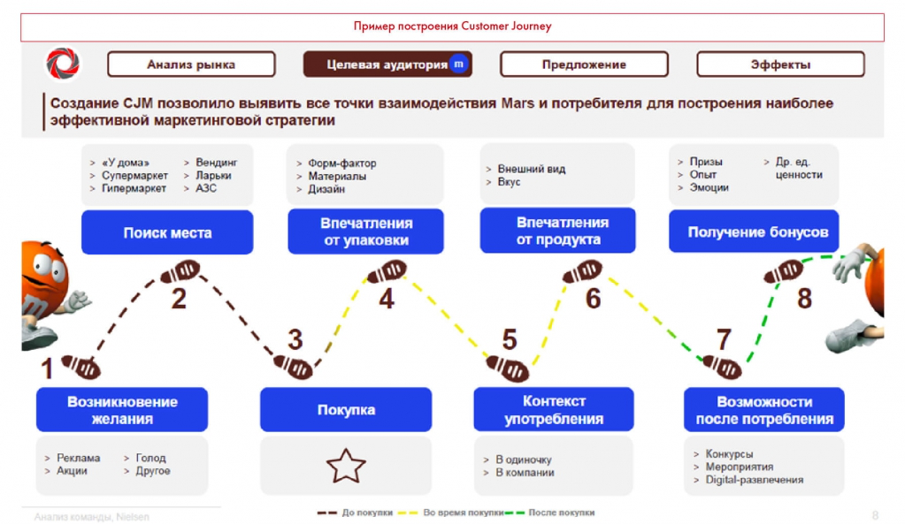

# Иллюстрация: PDF 187, изображение 1

Иллюстрация исходника: «Пример построения Customer Journey. Источник: Changellenge >> Cup». Подписи и числовые значения вынесены в расшифровку; порядок и связи элементов проверяются по сохранённому изображению.

Источник: [PDF 187](../../SOURCE.md#pdf-187).

Необходимая тема: [Как делать прогнозы и предпосылки](../../chapters/10-solution/09-forecasting.md).

## Текст изображения

> Автоматическая расшифровка. Подписи в сложных слайдах, рукописный текст и порядок колонок могут содержать ошибки OCR. Уточнения, проверенные таблицы и формулы выше имеют приоритет. Не интерпретируйте отсутствие распознанного текста как отсутствие данных в рисунке.

- Пример построения Customer Journey
- Анализ рынка
- Целевая аудитория
- Предложение
- Эффекты
- Создание CJM позволило выявить все точки взаимодействия Mars и потребителя для построения наиболее
- | эффективной маркетинговой стратегии
- «У дома»
- Супермаркет
- Гипермаркет
- • Вендинг
- > Ларьки
- > АЗС
- > Форм-фактор
- Материалы
- > Дизайн
- > Внешний вид
- > Вкус
- > Призы
- > Опыт
- > Эмоции
- > Др. ед.
- ценности
- Поиск места
- Впечатления
- от упаковки
- Впечатления
- от продукта
- Получение бонусов
- 6
- 8
- 3
- 5
- 1
- Возникновение
- желания
- Реклама
- Акции
- > Голод
- > Другое
- Покупка
- Контекст
- употребления
- > В одиночку
- > В компании
- - - До покупки
- Во время покупки- - После покупки
- Возможности
- после потребления
- > Конкурсы
- > Мероприятия
- > Digital-развлечения

## Связанные материалы

[Вернуться к теме](../../chapters/10-solution/09-forecasting.md) · [Ограничения распознавания](../../meta/issues.md)
