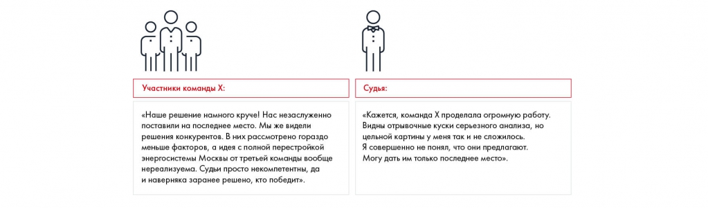

# Иллюстрация: PDF 190, изображение 1

На рисунке приведены элементы: Участники команды X:; «Наше решение намного круче! Нас незаслуженно; поставили на последнее место. Мы же видели; решения конкурентов. В них рассмотрено гораздо; меньше факторов, а идея с полной перестройкой. Полная текстовая расшифровка приведена отдельно; геометрия и цветовые обозначения сохранены на изображении.

Источник: [PDF 190](../../SOURCE.md#pdf-190).

Необходимая тема: [Презентация решения: общий процесс](../../chapters/11-presentation/01-process.md).

## Текст изображения

> Автоматическая расшифровка. Подписи в сложных слайдах, рукописный текст и порядок колонок могут содержать ошибки OCR. Уточнения, проверенные таблицы и формулы выше имеют приоритет. Не интерпретируйте отсутствие распознанного текста как отсутствие данных в рисунке.

- Участники команды X:
- «Наше решение намного круче! Нас незаслуженно
- поставили на последнее место. Мы же видели
- решения конкурентов. В них рассмотрено гораздо
- меньше факторов, а идея с полной перестройкой
- энергосистемы Москвы от третьей команды вообще
- нереализуема. Судьи просто некомпетентны, да
- и наверняка заранее решено, кто победит».
- Судья:
- «Кажется, команда Х проделала огромную работу.
- Видны отрывочные куски серьезного анализа, но
- цельной картины у меня так и не сложилось.
- Я совершенно не понял, что они предлагают.
- Могу дать им только последнее место».

## Связанные материалы

[Вернуться к теме](../../chapters/11-presentation/01-process.md) · [Ограничения распознавания](../../meta/issues.md)
