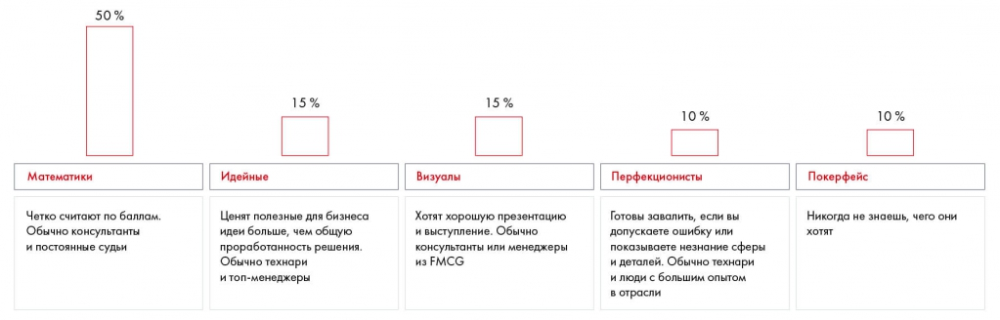

# Иллюстрация: PDF 194, изображение 1

На рисунке пять типов судей: математики (50 %), идейные (15 %), визуалы (15 %), перфекционисты (10 %), покерфейс (10 %). В основном тексте перед перечислением сказано «четыре»; это несогласованность источника, см. TXT-02.

Источник: [PDF 194](../../SOURCE.md#pdf-194).

Необходимая тема: [Определение целевой аудитории презентации](../../chapters/11-presentation/02-audience.md).

## Текст изображения

> Автоматическая расшифровка. Подписи в сложных слайдах, рукописный текст и порядок колонок могут содержать ошибки OCR. Уточнения, проверенные таблицы и формулы выше имеют приоритет. Не интерпретируйте отсутствие распознанного текста как отсутствие данных в рисунке.

- 50 %
- Математики
- Четко считают по баллам.
- Обычно консультанты
- и постоянные судьи
- 15%
- Идейные
- Ценят полезные для бизнеса
- идеи больше, чем общую
- проработанность решения.
- Обычно технари
- и топ-менеджеры
- 15%
- Визуалы
- Хотят хорошую презентацию
- и выступление. Обычно
- консультанты или менеджеры
- из FMCG
- 10 %
- Перфекционисты
- Готовы завалить, если вы
- допускаете ошибку или
- показываете незнание сферы
- и деталей. Обычно технари
- и люди с большим опытом
- в отрасли
- 10%
- Покерфейс
- Никогда не знаешь, чего они
- ХОТЯТ

## Связанные материалы

[Вернуться к теме](../../chapters/11-presentation/02-audience.md) · [Ограничения распознавания](../../meta/issues.md)
