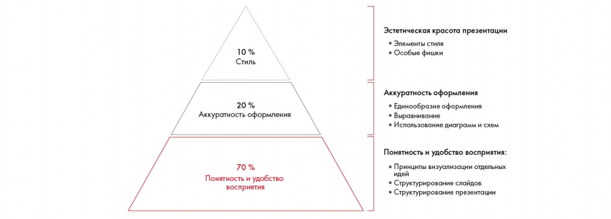

# Иллюстрация: PDF 196, изображение 1

На рисунке приведены элементы: 10 %; Стиль; 20 %; Аккуратность оформления; 70 %. Полная текстовая расшифровка приведена отдельно; геометрия и цветовые обозначения сохранены на изображении.

Источник: [PDF 196](../../SOURCE.md#pdf-196).

Необходимая тема: [Линия повествования презентации. Часть 1](../../chapters/11-presentation/03-storyline.md).

## Текст изображения

> Автоматическая расшифровка. Подписи в сложных слайдах, рукописный текст и порядок колонок могут содержать ошибки OCR. Уточнения, проверенные таблицы и формулы выше имеют приоритет. Не интерпретируйте отсутствие распознанного текста как отсутствие данных в рисунке.

- 10 %
- Стиль
- 20 %
- Аккуратность оформления
- 70 %
- Понятность и удобство
- восприятия
- Эстетическая красота презентации
- • Элементы стиля
- • Особые фишки
- Аккуратность оформления
- • Единообразие оформления
- • Выравнивание
- • Использование диаграмм и схем
- Понятность и удобство восприятия:
- • Принципы визуализации отдельных
- идей
- • Структурирование слайдов
- • Структурирование презентации

## Связанные материалы

[Вернуться к теме](../../chapters/11-presentation/03-storyline.md) · [Ограничения распознавания](../../meta/issues.md)
