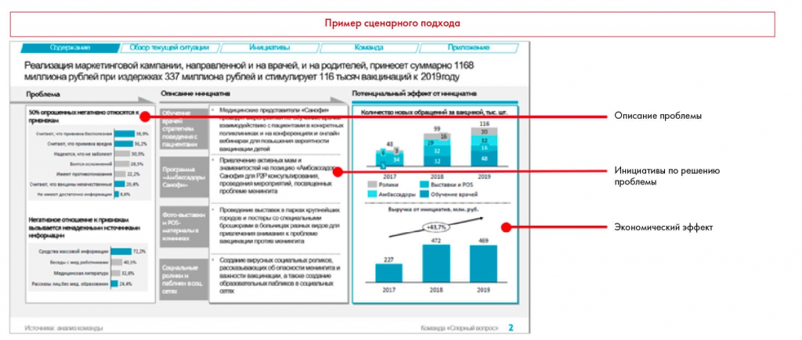

# Иллюстрация: PDF 198, изображение 1

Иллюстрация исходника: «Пример Executive Summary. Источник: Sanofi Health Guardians, решение команды». Подписи и числовые значения вынесены в расшифровку; порядок и связи элементов проверяются по сохранённому изображению.

Источник: [PDF 198](../../SOURCE.md#pdf-198).

Необходимая тема: [Линия повествования презентации. Часть 1](../../chapters/11-presentation/03-storyline.md).

## Текст изображения

> Автоматическая расшифровка. Подписи в сложных слайдах, рукописный текст и порядок колонок могут содержать ошибки OCR. Уточнения, проверенные таблицы и формулы выше имеют приоритет. Не интерпретируйте отсутствие распознанного текста как отсутствие данных в рисунке.

- Пример сценарного подхода
- Обзор текущей ситуации
- Ини зативы
- Команда
- Приложение
- Реализация маркетинговой кампании, направленной и на врачей, и на родителей, принесет суммарно 1168
- миллиона рублей при издержках 337 миллиона рублей и стимулирует 116 тысяч вакцинаций к 2019году
- Проблема
- Описанне ненциатня
- Потенцнальный эффент от ненциатне
- 50% опрошенельск нет атнено относится
- привнекам
- N.2%
- .....
- Негатненое отношение к привнекам
- высь ватся ненадежными исто-несни
- информаци
- 1712%
- ILAS
- Рассказы либез мед обваленни
- 24.45
- ......
- Количество новых обращений м видной, тыс, шт
- 116
- .....
- золиклиника и на конференцияк и онлайн
- Программа
- .......
- знакнитостой не позицию «Либсасова)
- Санофия для РИР консульлировани.
- проведения мероприятий, посвященных
- 2017
- Амбассадоры
- 2018
- • Выставки и POS
- • Обучение врачей
- 2019
- Фоло выставкИ
- матерналые
- .........
- городов и постеры со споциальн
- Орошорами в больницак разных видов для
- привлечения внимания к пробпоме
- .....
- выручка от имецкатив, млн руб.
- 441.7%
- Соцальные
- рольни м
- Создание вирусных социальных роликов.
- рассказь ваках об опасности ионингита и
- обоазовательных пабликов в социвльных
- Истовиво: анагио команды
- Команда «Спорный вопрос»
- 2
- Описание проблемы
- Инициативы по решению
- проблемы
- Экономический эффект
- 2017
- 2018
- 2019

## Связанные материалы

[Вернуться к теме](../../chapters/11-presentation/03-storyline.md) · [Ограничения распознавания](../../meta/issues.md)
