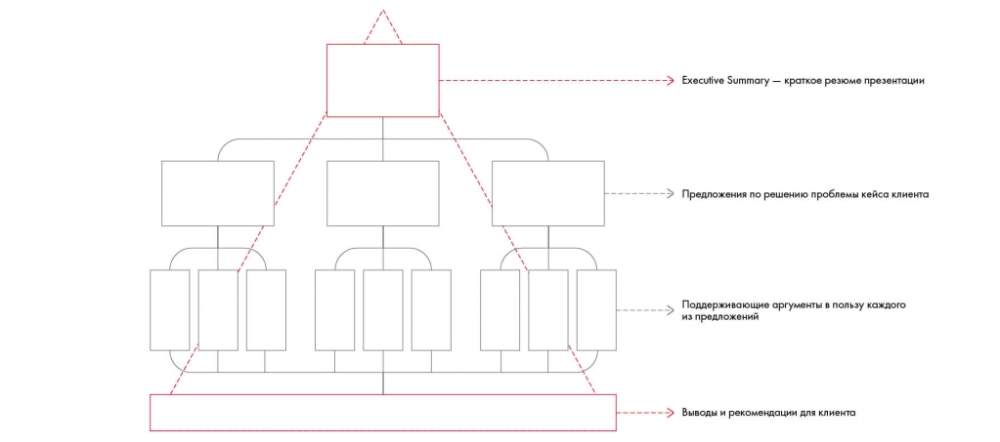

# Иллюстрация: PDF 198, изображение 2

Структура доказательного рассказа: Executive Summary → предложения → поддерживающие аргументы → выводы и рекомендации. Она переносит главный ответ к началу презентации.

Источник: [PDF 198](../../SOURCE.md#pdf-198).

Необходимая тема: [Линия повествования презентации. Часть 1](../../chapters/11-presentation/03-storyline.md).

## Текст изображения

> Автоматическая расшифровка. Подписи в сложных слайдах, рукописный текст и порядок колонок могут содержать ошибки OCR. Уточнения, проверенные таблицы и формулы выше имеют приоритет. Не интерпретируйте отсутствие распознанного текста как отсутствие данных в рисунке.

- Executive Summary - краткое резюме презентации
- -> Предложения по решению проблемы кейса клиента
- Поддерживающие аргументы в пользу каждого
- из предложений
- Выводы и рекомендации для клиента

## Связанные материалы

[Вернуться к теме](../../chapters/11-presentation/03-storyline.md) · [Ограничения распознавания](../../meta/issues.md)
