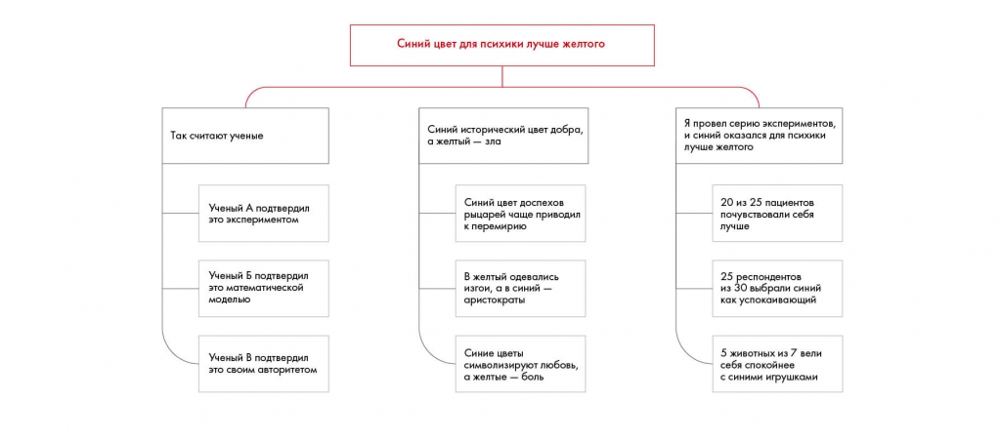

# Иллюстрация: PDF 199, изображение 1

На рисунке приведены элементы: Синий цвет для психики лучше желтого; Так считают ученые; Синий исторический цвет добра,; а желтый - зла; Я провел серию экспериментов,. Полная текстовая расшифровка приведена отдельно; геометрия и цветовые обозначения сохранены на изображении.

Источник: [PDF 199](../../SOURCE.md#pdf-199).

Необходимая тема: [Линия повествования презентации. Часть 1](../../chapters/11-presentation/03-storyline.md).

## Текст изображения

> Автоматическая расшифровка. Подписи в сложных слайдах, рукописный текст и порядок колонок могут содержать ошибки OCR. Уточнения, проверенные таблицы и формулы выше имеют приоритет. Не интерпретируйте отсутствие распознанного текста как отсутствие данных в рисунке.

- Синий цвет для психики лучше желтого
- Так считают ученые
- Синий исторический цвет добра,
- а желтый - зла
- Я провел серию экспериментов,
- и синий оказался для психики
- лучше желтого
- Ученый А подтвердил
- это экспериментом
- Синий цвет доспехов
- рыцарей чаще приводил
- 20 из 25 пациентов
- почувствовали себя
- лучше
- Ученый Б подтвердил
- это математической
- моделью
- В желтый одевались
- изгои, а в синий -
- аристократы
- 25 респондентов
- из 30 выбрали синий
- как успокаивающий
- Ученый В подтвердил
- это своим авторитетом
- Синие цветы
- символизируют любовь,
- а желтые - боль
- 5 животных из 7 вели
- себя спокойнее
- с синими игрушками

## Связанные материалы

[Вернуться к теме](../../chapters/11-presentation/03-storyline.md) · [Ограничения распознавания](../../meta/issues.md)
