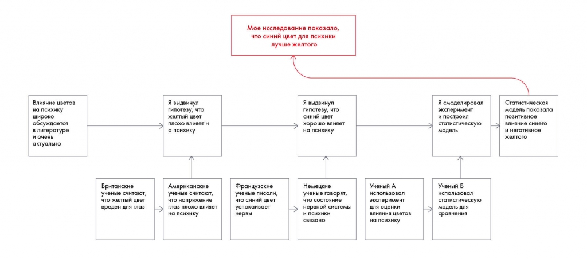

# Иллюстрация: PDF 200, изображение 1

На рисунке приведены элементы: Мое исследование показало,; что синий цвет для психики; лучше желтого; Влияние цветов; на психику. Полная текстовая расшифровка приведена отдельно; геометрия и цветовые обозначения сохранены на изображении.

Источник: [PDF 200](../../SOURCE.md#pdf-200).

Необходимая тема: [Линия повествования презентации. Часть 1](../../chapters/11-presentation/03-storyline.md).

## Текст изображения

> Автоматическая расшифровка. Подписи в сложных слайдах, рукописный текст и порядок колонок могут содержать ошибки OCR. Уточнения, проверенные таблицы и формулы выше имеют приоритет. Не интерпретируйте отсутствие распознанного текста как отсутствие данных в рисунке.

- Мое исследование показало,
- что синий цвет для психики
- лучше желтого
- Влияние цветов
- на психику
- широко
- обсуждается
- в литературе
- и очень
- актуально
- Я выдвинул
- гипотезу, что
- желтый цвет
- плохо влияет н
- а психику
- >
- Я выдвинул
- гипотезу, что
- синий цвет
- хорошо влияет
- на психику
- Я смоделировал
- эксперимент
- и построил
- статистическую
- модель
- Британские
- ученье считоют,
- что желтый ивет
- вреден для глаз
- Американские
- ученые считаюь,
- что напряженис
- глаз плохо влияет
- на психику
- Французские
- ученье писали,
- что синий ивет
- успокаиваст
- нервы
- Немецкие
- ученые говорят,
- нервной системы
- и психики
- связано
- Ученый А
- зкаперимент
- влияния цветов
- на психику
- Ученый Б
- статистическую
- сравнения
- Статистическая
- модель показала
- позитивное
- влияние синего
- и негативное
- желтого

## Связанные материалы

[Вернуться к теме](../../chapters/11-presentation/03-storyline.md) · [Ограничения распознавания](../../meta/issues.md)
