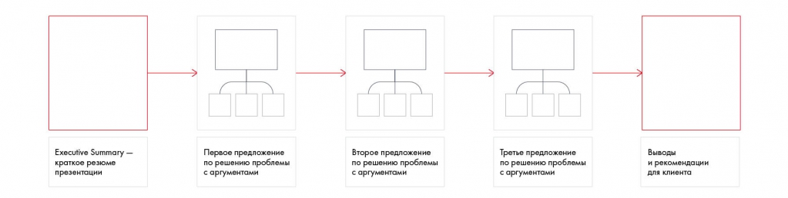

# Иллюстрация: PDF 202, изображение 1

На рисунке приведены элементы: Executive Summary -; краткое резюме; презентации; Первое предложение; по решению проблемы. Полная текстовая расшифровка приведена отдельно; геометрия и цветовые обозначения сохранены на изображении.

Источник: [PDF 202](../../SOURCE.md#pdf-202).

Необходимая тема: [Линия повествования презентации. Часть 1](../../chapters/11-presentation/03-storyline.md).

## Текст изображения

> Автоматическая расшифровка. Подписи в сложных слайдах, рукописный текст и порядок колонок могут содержать ошибки OCR. Уточнения, проверенные таблицы и формулы выше имеют приоритет. Не интерпретируйте отсутствие распознанного текста как отсутствие данных в рисунке.

- Executive Summary -
- краткое резюме
- презентации
- Первое предложение
- по решению проблемы
- с аргументами
- Второе предложение
- по решению проблемы
- с аргументами
- Третье предложение
- по решению проблемы
- с аргументами
- Выводы
- и рекомендации
- для клиента

## Связанные материалы

[Вернуться к теме](../../chapters/11-presentation/03-storyline.md) · [Ограничения распознавания](../../meta/issues.md)
