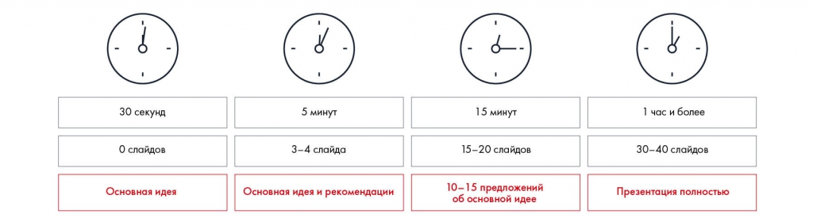

# Иллюстрация: PDF 205, изображение 1

Объём рассказа зависит от времени: 30 секунд без слайдов, 5 минут на основной ответ и рекомендации, 15 минут на более подробное обоснование. Все значения объёма перенесены в расшифровку.

Источник: [PDF 205](../../SOURCE.md#pdf-205).

Необходимая тема: [Линия повествования презентации. Часть 2: раскадровка](../../chapters/11-presentation/04-storyboard.md).

## Текст изображения

> Автоматическая расшифровка. Подписи в сложных слайдах, рукописный текст и порядок колонок могут содержать ошибки OCR. Уточнения, проверенные таблицы и формулы выше имеют приоритет. Не интерпретируйте отсутствие распознанного текста как отсутствие данных в рисунке.

- 30 секунд
- 0 слайдов
- Основная идея
- 5 минут
- 3-4 слайда
- Основная идея и рекомендации
- 15 минут
- 15-20 слайдов
- 10-15 предложений
- об основной идее
- 1 час и более
- 30-40 слайдов
- Презентация полностью

## Связанные материалы

[Вернуться к теме](../../chapters/11-presentation/04-storyboard.md) · [Ограничения распознавания](../../meta/issues.md)
