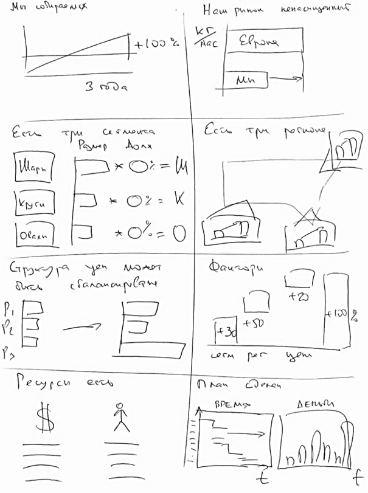

# Иллюстрация: PDF 207, изображение 1

Иллюстрация исходника: «Примерно так выглядит раскадровка презентации». Подписи и числовые значения вынесены в расшифровку; порядок и связи элементов проверяются по сохранённому изображению.

Источник: [PDF 207](../../SOURCE.md#pdf-207).

Необходимая тема: [Линия повествования презентации. Часть 2: раскадровка](../../chapters/11-presentation/04-storyboard.md).

## Текст изображения

> Автоматическая расшифровка. Подписи в сложных слайдах, рукописный текст и порядок колонок могут содержать ошибки OCR. Уточнения, проверенные таблицы и формулы выше имеют приоритет. Не интерпретируйте отсутствие распознанного текста как отсутствие данных в рисунке.

- Ma collpaenax
- +100%
- З года
- Ecu
- Wapn
- kyru
- Olcan
- Ces mouca
- Размер Доля
- →×O:=M
- * O%= K
- *0 = 0
- (ranancupilane
- Ресурси ессь
- Наш рынок ненасищенный
- HaC
- Elpane
- Ест три pornane
- Дангори
- + 100%
- +30
- +50
- cern per yen
- План сделан
- BPEMS

## Связанные материалы

[Вернуться к теме](../../chapters/11-presentation/04-storyboard.md) · [Ограничения распознавания](../../meta/issues.md)
