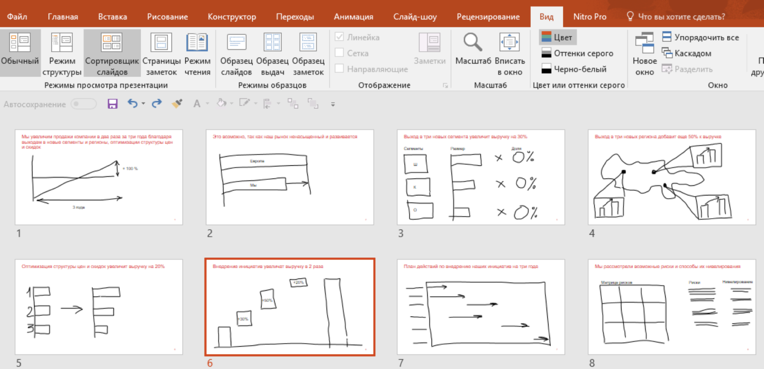

# Иллюстрация: PDF 208, изображение 1

На рисунке приведены элементы: Файл; Главная; Вставка; Рисование; Конструктор. Полная текстовая расшифровка приведена отдельно; геометрия и цветовые обозначения сохранены на изображении.

Источник: [PDF 208](../../SOURCE.md#pdf-208).

Необходимая тема: [Линия повествования презентации. Часть 2: раскадровка](../../chapters/11-presentation/04-storyboard.md).

## Текст изображения

> Автоматическая расшифровка. Подписи в сложных слайдах, рукописный текст и порядок колонок могут содержать ошибки OCR. Уточнения, проверенные таблицы и формулы выше имеют приоритет. Не интерпретируйте отсутствие распознанного текста как отсутствие данных в рисунке.

- Файл
- Главная
- Вставка
- Рисование
- Конструктор
- Переходы
- Обычный
- Режим
- Сортировщик Страницы Режим
- IHYAIYPO
- слайдов
- чтения
- Режимы просмотра поезентации
- Образец Образец Образец
- слайдов
- заметок
- сжиин ooossuot
- Анимация
- • Линейка
- Сетка
- • | Направляющие
- отображенно
- Слайд-шоу
- Рецензирование
- Вид
- Nitro Pro
- Заметки!
- Масштаб Вписать
- в окно
- SuTSE
- Цвет
- - Оттенки серого
- - Черно-белый
- • Что вы хотите сделать?
- В Упорядочить все
- В Каскадом
- ОКНо
- То Разделить
- OKHO)
- × Ö%
- 0%
- 0%

## Связанные материалы

[Вернуться к теме](../../chapters/11-presentation/04-storyboard.md) · [Ограничения распознавания](../../meta/issues.md)
